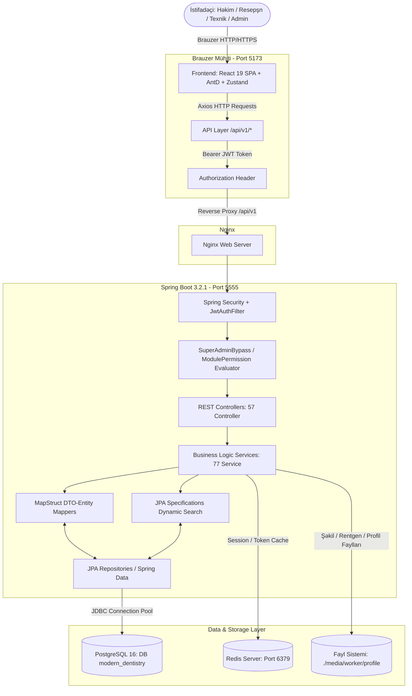
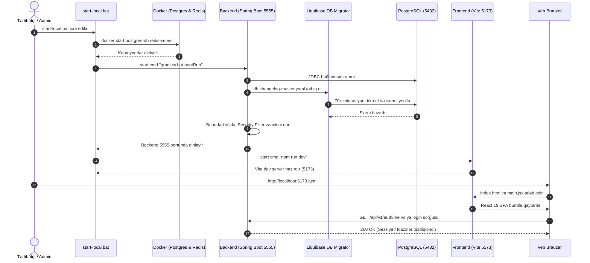
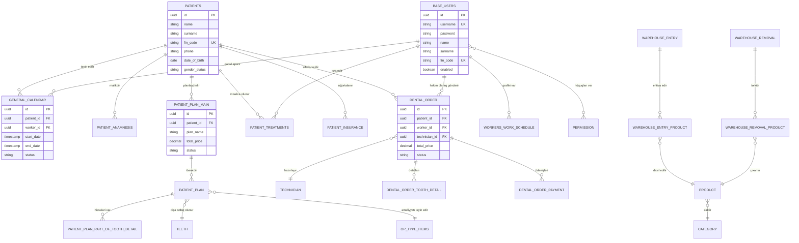
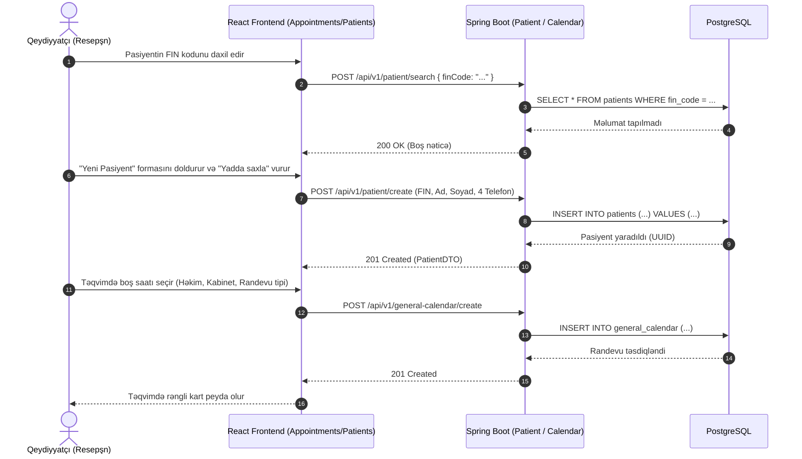
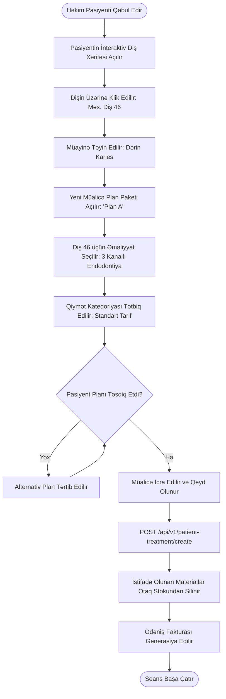
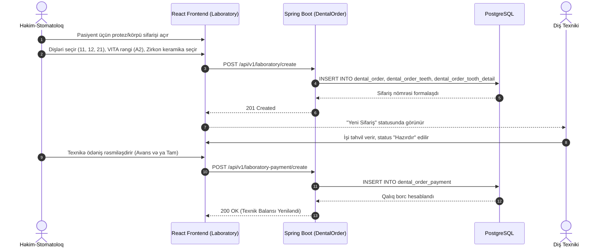
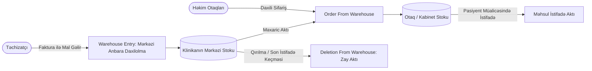

# MD-Son: Modern Dentistry ERP Platforması
## Tam Texniki Layihə Sənədi (Full Project Architecture & Technical Documentation)

> **Müəllif:** Senior Software Architect, Technical Writer və Code Auditor  
> **Status:** Rəsmi Təsdiqlənmiş Tam Texniki Sənəd  
> **Layihə Adı:** MD-Son (Modern Dentistry / Müasir Stomatologiya İdarəetmə Sistemi)  
> **Backend Namespace:** `com.rustam.modern_dentistry`  
> **Frontend Tətbiq Adı:** `muasirstomatologiya`  
> **Tərtib Tarixi:** 2026-10-29  
> **Versiya:** 1.0.0-PROD  
> **Fayl:** `PROJECT_DOCUMENTATION.md`  

---

# Məzmun Cədvəli (Table of Contents)

* [0. Sənəd Başlığı və Metadata](#0-sənəd-başlığı-və-metadata)
* [1. İcmal (Executive Summary)](#1-icmal-executive-summary)
  * [1.1 Layihənin Təyinatı və Həll Etdiyi Problemlər](#11-layihənin-təyinatı-və-həll-etdiyi-problemlər)
  * [1.2 İstifadəçi Profilləri və Rollar](#12-istifadəçi-profilləri-və-rollar)
  * [1.3 Əsas Funksional İmkanlar (Feature Matrix)](#13-əsas-funksional-imkanlar-feature-matrix)
  * [1.4 Sistem Tipi və Kateqoriyası](#14-sistem-tipi-və-kateqoriyası)
* [2. Texnologiya Stack-i](#2-texnologiya-stack-i)
  * [2.1 Backend Texnoloji Yığını](#21-backend-texnoloji-yığını)
  * [2.2 Frontend Texnoloji Yığını](#22-frontend-texnoloji-yığını)
  * [2.3 Verilənlər Bazası, Keş və İnfrastruktur](#23-verilənlər-bazası-keş-və-infrastruktur)
  * [2.4 DevOps, Avtomatlaşdırma və Köməkçi Alətlər](#24-devops-avtomatlaşdırma-və-köməkçi-alətlər)
* [3. Fayl və Qovluq Strukturu](#3-fayl-və-qovluq-strukturu)
  * [3.1 Ümumi Repozitori Ağacı](#31-ümumi-repozitori-ağacı)
  * [3.2 Backend Qovluqlarının Məsuliyyəti](#32-backend-qovluqlarının-məsuliyyəti)
  * [3.3 Frontend Qovluqlarının Məsuliyyəti](#33-frontend-qovluqlarının-məsuliyyəti)
  * [3.4 Script və Sənədlər Qovluğu](#34-script-və-sənədlər-qovluğu)
  * [3.5 Adlandırma və Kod Təşkili Standartları](#35-adlandırma-və-kod-təşkili-standartları)
* [4. Arxitektura](#4-arxitektura)
  * [4.1 Ümumi Arxitektura Üslubu (Layered Architecture & SPA)](#41-ümumi-arxitektura-üslubu-layered-architecture--spa)
  * [4.2 Komponentlərin Əlaqə Diaqramı (Mermaid)](#42-komponentlərin-əlaqə-diaqramı-mermaid)
  * [4.3 Laylar və Məsuliyyət Bölgüsü (Separation of Concerns)](#43-laylar-və-məsuliyyət-bölgüsü-separation-of-concerns)
  * [4.4 Şəbəkə və Kommunikasiya Protokolları](#44-şəbəkə-və-kommunikasiya-protokolları)
  * [4.5 Tətbiq Olunan Dizayn Pattern-ləri](#45-tətbiq-olunan-dizayn-pattern-ləri)
* [5. Giriş Nöqtələri və Başlanğıc Axını](#5-giriş-nöqtələri-və-başlanğıc-axını)
  * [5.1 Backend Başlanğıc Axını (`ModernDentistryApplication`)](#51-backend-başlanğıc-axını-moderndentistryapplication)
  * [5.2 Frontend Başlanğıc Axını (`main.jsx`)](#52-frontend-başlanğıc-axını-mainjsx)
  * [5.3 Lokal Başlanğıc Skripti (`start-local.bat`)](#53-lokal-başlanğıc-skripti-start-localbat)
  * [5.4 Başlanğıc və Bootstrapping Sequence Diaqramı](#54-başlanğıc-və-bootstrapping-sequence-diaqramı)
* [6. Modul-Modul / Fayl-Fayl Detallı Sənədləşmə](#6-modul-modul--fayl-fayl-detallı-sənədləşmə)
  * [6.1 Backend Core, Təhlükəsizlik və Əsas Konfiqurasiya](#61-backend-core-təhlükəsizlik-və-əsas-konfiqurasiya)
  * [6.2 İstifadəçilər, Həkimlər və Dinamik Səlahiyyətlər (RBAC)](#62-istifadəçilər-həkimlər-və-dinamik-səlahiyyətlər-rbac)
  * [6.3 Pasiyentlər, Tibbi Kart və Klinik Tarixçə](#63-pasiyentlər-tibbi-kart-və-klinik-tarixçə)
  * [6.4 Diş Xəritəsi (Dental Chart) və Müalicə Planları](#64-diş-xəritəsi-dental-chart-və-müalicə-planları)
  * [6.5 Təqvim, Randevu və Rezervasiya Sistemi](#65-təqvim-randevu-və-rezervasiya-sistemi)
  * [6.6 Diş Laboratoriyası və Texnik İdarəetməsi](#66-diş-laboratoriyası-və-texnik-idarəetməsi)
  * [6.7 Sığorta Şirkətləri və Pasiyent Sığorta Balansı](#67-sığorta-şirkətləri-və-pasiyent-sığorta-balansı)
  * [6.8 Əməliyyat Kateqoriyaları və Qiymət Cədvəlləri](#68-əməliyyat-kateqoriyaları-və-qiymət-cədvəlləri)
  * [6.9 Çoxşaxəli Anbar Sistemi (Mərkəzi, Otaq, Daxilolma, Çıxarış, Silinmə)](#69-çoxşaxəli-anbar-sistemi-mərkəzi-otaq-daxilolma-çıxarış-silinmə)
  * [6.10 Maliyyə, Fakturalar, Ödənişlər və Hesabatlar](#610-maliyyə-fakturalar-ödənişlər-və-hesabatlar)
  * [6.11 Frontend Modulları, Zustand Store-lar və Komponentlər](#611-frontend-modulları-zustand-store-lar-və-komponentlər)
  * [6.12 Köməkçi Python Skriptləri və Avtomatlaşdırma](#612-köməkçi-python-skriptləri-və-avtomatlaşdırma)
* [7. Verilənlər Modeli](#7-verilənlər-modeli)
  * [7.1 Əlaqələr Diaqramı (Mermaid ERD)](#71-əlaqələr-diaqramı-mermaid-erd)
  * [7.2 Cədvəllərin Tam Siyahısı və Sahələri (65+ Cədvəl)](#72-cədvəllərin-tam-siyahısı-və-sahələri-65-cədvəl)
  * [7.3 Miqrasiya Tarixçəsi (Liquibase Changelog)](#73-miqrasiya-tarixçəsi-liquibase-changelog)
* [8. API / İnterfeys Sənədi](#8-api--interfeys-sənədi)
  * [8.1 Bütün 57 REST Controller üzrə Endpoint Cədvəli](#81-bütün-57-rest-controller-üzrə-endpoint-cədvəli)
* [9. Əsas Biznes Axınları (End-to-End)](#9-əsas-biznes-axınları-end-to-end)
  * [9.1 Pasiyentin İlk Qeydiyyatı və Randevu Təyini](#91-pasiyentin-ilk-qeydiyyatı-və-randevu-təyini)
  * [9.2 Diş Müayinəsi, Plan Yaradılması və Müalicə İcrası](#92-diş-müayinəsi-plan-yaradılması-və-müalicə-icrası)
  * [9.3 Laboratoriya Sifarişi və Texnik Hesablaşması](#93-laboratoriya-sifarişi-və-texnik-hesablaşması)
  * [9.4 Anbara Daxilolma, Otağa Transfer və Məxaric](#94-anbara-daxilolma-otağa-transfer-və-məxaric)
  * [9.5 Maliyyə Hesabatı və Həkim Qazancı](#95-maliyyə-hesabatı-və-həkim-qazancı)
* [10. Autentifikasiya, Avtorizasiya və Təhlükəsizlik](#10-autentifikasiya-avtorizasiya-və-təhlükəsizlik)
  * [10.1 JWT və Stateless Sessiya Arxitekturası](#101-jwt-və-stateless-sessiya-arxitekturası)
  * [10.2 Modul Əsaslı İcazə Mexanizmi (RBAC)](#102-modul-əsaslı-icazə-mexanizmi-rbac)
  * [10.3 Təhlükəsizlik Zəiflikləri və Boşluqların Auditi](#103-təhlükəsizlik-zəiflikləri-və-boşluqların-auditi)
* [11. Konfiqurasiya və Mühit Dəyişənləri](#11-konfiqurasiya-və-mühit-dəyişənləri)
* [12. Quraşdırma, İşə Salma və Deployment](#12-quraşdırma-işə-salma-və-deployment)
  * [12.1 Ön Şərtlər və Tələblər](#121-ön-şərtlər-və-tələblər)
  * [12.2 Lokal Quraşdırma (Addım-addım)](#122-lokal-quraşdırma-addım-addım)
  * [12.3 Production Server Deployment Axını](#123-production-server-deployment-axını)
* [13. Error Handling, Logging və Monitorinq](#13-error-handling-logging-və-monitorinq)
* [14. Test Strategiyası və Boşluqlar](#14-test-strategiyası-və-boşluqlar)
* [15. Performans və Miqyaslanma Analizi](#15-performans-və-miqyaslanma-analizi)
* [16. Asılılıqlar və Üçüncü Tərəf Servislər](#16-asılılıqlar-və-üçüncü-tərəf-servislər)
* [17. Kod Keyfiyyəti və Texniki Borc](#17-kod-keyfiyyəti-və-texniki-borc)
* [18. Məlum Problemlər, Risklər və Çatışmazlıqlar](#18-məlum-problemlər-risklər-və-çatışmazlıqlar)
* [19. Tövsiyələr və Yol Xəritəsi](#19-tövsiyələr-və-yol-xəritəsi)
* [20. Lüğət (Glossary)](#20-lüğət-glossary)
* [21. Açıq Suallar](#21-açıq-suallar)
* [22. Əlavələr](#22-əlavələr)
  * [Əlavə A: Bütün Faylların Siyahısı və Qısa Təsviri](#əlavə-a-bütün-faylların-siyahısı-və-qısa-təsviri)
  * [Əlavə B: Əsas Funksiya və Klass İndeksi](#əlavə-b-əsas-funksiya-və-klass-indeksi)
  * [Əlavə C: Bütün ENV və Konfiqurasiya Parametrləri](#əlavə-c-bütün-env-və-konfiqurasiya-parametrləri)
  * [Əlavə D: Endpoint-lərin Sürətli Xülasəsi](#əlavə-d-endpoint-lərin-sürətli-xülasəsi)

---

## 0. Sənəd Başlığı və Metadata

* **Layihənin Rəsmi Adı:** MD-Son (Modern Dentistry / Müasir Stomatologiya İdarəetmə Sistemi)
* **Backend Namespace:** `com.rustam.modern_dentistry`
* **Frontend Layihə Adı:** `muasirstomatologiya`
* **Sənədin Tərtib Tarixi:** 2026-10-29
* **Sənədin Müəllifi:** Senior Software Architect, Technical Writer & Code Auditor
* **Analiz Edilən Aktiv Mənbə Fayllarının Sayı:** **1,615 fayl**
  * Java Mənbə Faylları: 747 fayl
  * React JSX Faylları: 302 fayl
  * Stil (CSS) Faylları: 155 fayl
  * Konfiqurasiya və Miqrasiya (YAML, Properties): 159 fayl
  * JavaScript (Stores, API, Utils): 133 fayl
  * Python Skriptləri: 9 fayl
  * Digər (Batch, JSON, Şəkillər, Sənədlər): 110+ fayl
* **Təxmini Kod/Mətn Həcmi:** **~578,139 sətir**
* **Analizin Əhatə Dairəsi və Məhdudiyyətləri:**
  * Təhlil bilavasitə `c:\Users\User\Desktop\MD-Son` işçi qovluğundakı canlı mənbə kodlarına əsaslanır.
  * Təhlükəsizlik qaydalarına əsasən layihədə tapılmış bütün real parollar, SSH parolu və JWT secret açarları sənəddə `[REDACTED]` formatında göstərilmişdir.

---

## 1. İcmal (Executive Summary)

### 1.1 Layihənin Təyinatı və Həll Etdiyi Problemlər
**MD-Son (Modern Dentistry)** — müasir stomatologiya klinikaları və diş texniki laboratoriyalarının gündəlik tibbi, inzibati, anbar və maliyyə əməliyyatlarını vahid mərkəzdən idarə etmək üçün yaradılmış Enterprise Practice Management & ERP platformasıdır.

Sistem stomatologiya sahəsindəki aşağıdakı kritik problemləri həll edir:
1. **Pasiyentin Tibbi Tarixçəsinin Parçalanması:** Pasiyentin əvvəlki müayinələri, çəkilmiş rentgen və foto/video faylları, xroniki xəstəlik və allergiyaları (anamnez) vahid elektron kartda cəmlənir.
2. **Qeyri-Dəqiq Diş Diaqramı və Müalicə Planlaması:** İnteraktiv SVG əsaslı 32 diş xəritəsi üzərində hər bir dişin tac və kök vəziyyəti, aparılmış əməliyyatlar vizual qeyd olunur və bir neçə alternativ qiymət planı tərtib edilərək pasiyentlə müqayisəli razılaşdırılır.
3. **Anbar Qalıqlarına Nəzarətsizlik və İtki Riski:** Mərkəzi anbar ilə otaqlar (kabinetlər) arasındakı məhsul axını, daxilolma qaimələri, istifadə aktları və yararsız məhsulların silinməsi dəqiq qeydiyyata alınır.
4. **Diş Texniki Laboratoriyası ilə Rabitəsizlik:** Hazırlanacaq keramik, metal, implant qapaq və körpülərin parametrləri (rəng, ölçü, qarnir), texnikin qiymət cədvəli və laboratoriya borcları avtomatlaşdırılır.
5. **Həkimlərin Qeyri-Şəffaf Qazanc Hesablaması:** Həkimlərin ixtisasları, kabinet növbələri, icra etdikləri əməliyyatlardan əldə olunan gəlirlər və xərclər avtomatik hesablanır.

### 1.2 İstifadəçi Profilləri və Rollar
* **Super Admin / Klinika Sahibi:** Bütün modullara tam və məhdudiyyətsiz giriş, maliyyə hesabatları, işçi və icazə idarəsi.
* **Həkim-Stomatoloq:** Öz pasiyentləri, randevuları, diş müayinəsi, müalicə planları, resept yazılışı və laboratoriya sifarişləri.
* **Qeydiyyatçı (Resepşn):** Pasiyentlərin ilkin qeydiyyatı, ümumi təqvimdə randevuların təyini, rezervasiyalar, kabinet növbələri və qara siyahı nəzarəti.
* **Anbar Müdiri:** Məhsul kataloqu, daxilolma fakturaları, kabinetlərə paylanma, silinmə aktları və kritik stok həyəcanları.
* **Diş Texniki / Laboratoriya Əməkdaşı:** Həkimlərdən gələn sifarişlərin qəbulu, statuslarının dəyişdirilməsi və ödəniş hesabatları.
* **Sığorta Mütəxəssisi:** Sığorta şirkətləri, sığortalı pasiyentlərin limitləri, əməliyyat paketləri və qalıq balansları.

### 1.3 Əsas Funksional İmkanlar (Feature Matrix)
* **Elektron Pasiyent Kartı:** Fərdi məlumatlar, 4 mərhələli əlaqə nömrələri, anadangəlmə və yoluxucu xəstəliklər, qara siyahı səbəbləri.
* **İnteraktiv Diş Xəritəsi (Adult & Child Dental Chart):** Dişlərin rəngli qrafik təsviri, hər diş üzrə əməliyyatların seçimi, foto və rentgen arxivinin əlaqələndirilməsi.
* **Randevu və Həkim Qrafiki:** Həkimlərin kabinetlər üzrə iş cədvəli, təqvim inteqrasiyası (`React Big Calendar`), rəng kodlaşdırması.
* **Laboratoriya İdarəsi:** Texnik qiymətləri, diş körpüləri (bridge), laboratoriya sifarişinin PDF/şəkil əlavələri və ödəniş statusu.
* **Çoxşaxəli Anbar Sistemi:** Klinika stoku, kabinet stoku, anbar sifarişləri, məhsul silinmələri və minimum qalıq xəbərdarlıqları.
* **Maliyyə və Hesabatlılıq:** Fakturalar (invoices), ödənişlər (payments), dövriyyə cədvəli və Apache POI ilə Excel ixracı.
* **Dinamik Modul RBAC:** Super Admin tərəfindən istənilən işçiyə modul səviyyəsində oxuma, yaratma, yeniləmə və silmə hüququnun verilməsi.

### 1.4 Sistem Tipi və Kateqoriyası
* **Sistem Növü:** Enterprise Health ERP / Practice Management System (PMS).
* **Arxitektura Modeli:** Single Page Application (SPA) + Layered RESTful Backend Monolith.

---

## 2. Texnologiya Stack-i

| Kateqoriya | Texnologiya | Versiya | İstifadə Məqsədi | Mənbə Sənəd |
| :--- | :--- | :--- | :--- | :--- |
| **Backend Runtime** | Java OpenJDK | 17 (LTS) | Əsas icra mühiti | `backend/build.gradle:L11` |
| **Backend Framework** | Spring Boot | 3.2.1 | API, IoC konteyner, MVC, Tranzaksiyalar | `backend/build.gradle:L3` |
| **Asılılıq İdarəedicisi**| Gradle Wrapper | 8.x | Layihə qurulması və asılılıqların idarəsi | `backend/build.gradle` |
| **ORM / Data Access** | Spring Data JPA / Hibernate | 6.x | Entity idarəsi, Repository və Spesifikasiyalar | `backend/build.gradle:L31` |
| **Verilənlər Bazası** | PostgreSQL | 42.7.3 Driver | Əsas relyasion verilənlər bazası | `backend/build.gradle:L44` |
| **Sxem Miqrasiyası** | Liquibase Core | 4.x | Verilənlər bazası versiyalaşdırılması (70+ YAML) | `backend/build.gradle:L38` |
| **Təhlükəsizlik** | Spring Security + JJWT | 6.x / 0.11.2 | Stateless JWT Bearer Auth və modul RBAC | `backend/build.gradle:L33,L40` |
| **Keşləmə & Sessiya** | Redis (Spring Data Redis)| Starter | Refresh tokenlərin saxlanması və keşləmə | `backend/build.gradle:L36` |
| **Obyekt Çevirici** | MapStruct + ModelMapper | 1.5.5 / 3.2.0 | Entity ↔ DTO yüksək performanslı çevrilmə | `backend/build.gradle:L39,L61` |
| **Ofis / Hesabat** | Apache POI (ooxml) | 5.4.0 | Excel hesabatlarının generasiyası | `backend/build.gradle:L55` |
| **API Sənədləşməsi** | SpringDoc OpenAPI | 2.0.3 | Swagger UI interfeysi (`/swagger-ui/index.html`) | `backend/build.gradle:L37` |
| **Frontend Platforma** | React | 19.0.0 | Müasir komponent əsaslı istifadəçi interfeysi | `frontend/package.json:L31` |
| **Frontend Bundler** | Vite | 6.2.0 | Sürətli HMR və istehsalat modullaşdırılması | `frontend/package.json:L67` |
| **UI Kitabxanası** | Ant Design (AntD) | 5.27.6 | Korporativ cədvəllər, modallar, pəncərələr | `frontend/package.json:L27` |
| **Əlavə UI / Stillər** | Tailwind CSS + MUI | 4.1.3 / 7.1.2 | CSS utilitləri və zəngin vizual komponentlər | `frontend/package.json:L22,L45` |
| **State Management** | Zustand | 5.0.3 | Qlobal klient vəziyyət idarəsi (55 store) | `frontend/package.json:L50` |
| **Asinxron Sorğular** | TanStack React Query | 5.73.3 | Server sorğularının idarəsi və keşlənməsi | `frontend/package.json:L24` |
| **HTTP Klient** | Axios | 1.9.0 | REST API ilə əlaqə və interceptor idarəsi | `frontend/package.json:L28` |
| **Klient Marşrutları**| React Router DOM | 7.5.3 | Çoxsəhifəli SPA naviqasiyası | `frontend/package.json:L38` |
| **Təqvim Qrafiki** | React Big Calendar | 1.19.4 | Həkim randevularının təqvim görünüşü | `frontend/package.json:L32` |
| **Form Validasiyası** | React Hook Form + Yup | 7.55.0 / 1.6.1 | Formaların yoxlanılması və validasiyası | `frontend/package.json:L36,L49` |
| **Avtomatlaşdırma** | Python | 3.11+ | Deploy, məlumat importu və köməkçi utilitlər | `script/deploy_to_server.py` |
| **Konteynerləşdirmə** | Docker & Docker Compose| Latest | PostgreSQL, Redis və Nginx servislərinin idarəsi | `start-local.bat:L8` |

---

## 3. Fayl və Qovluq Strukturu

### 3.1 Ümumi Repozitori Ağacı

```text
MD-Son/
├── backend/                                  # Spring Boot REST API Servisi
│   ├── build.gradle                          # Layihənin əsas Gradle asılılıq faylı
│   ├── settings.gradle                       # Layihə adı və modul konfiqurasiyası
│   ├── gradlew / gradlew.bat                 # Əməliyyat sistemi üçün Gradle wrapper
│   ├── nginx/nginx.conf                      # Server üçün Nginx reverse-proxy qaydaları
│   └── src/
│       ├── main/java/com/rustam/modern_dentistry/
│       │   ├── ModernDentistryApplication.java # [ENTRY POINT] Backend əsas başladıcı
│       │   ├── config/                       # Təhlükəsizlik, CORS, Redis, Swagger (6 fayl)
│       │   ├── controller/                   # REST Controller-lər (57 fayl)
│       │   ├── dao/                          # JPA Entity və Repozitorilər (139 fayl)
│       │   ├── dto/                          # DTO-lar: Request, Response, Criteria (300 fayl)
│       │   ├── exception/                    # GlobalExceptionHandler və xüsusi xətalar (20 fayl)
│       │   ├── mapper/                       # MapStruct Entity ↔ DTO çeviriciləri (48 fayl)
│       │   ├── service/                      # Biznes məntiqi layı (77 servis)
│       │   └── util/                         # JPA Specifications, JWT, UserDetails (53 fayl)
│       └── main/resources/
│           ├── application.yaml              # Əsas sistem sazlamaları
│           ├── application-dev.yaml          # Lokal inkişaf profili (Postgres, Redis)
│           ├── application-prod.yaml         # Production mühit profili
│           └── db/changelog/                 # Liquibase miqrasiya skriptləri (74 fayl)
│
├── frontend/                                 # React 19 SPA Tətbiqi
│   ├── package.json                          # Asılılıqlar və işəsalma skriptləri
│   ├── vite.config.js                        # Vite konfiqurasiyası və optimizasiyalar
│   ├── .env                                  # Mühit dəyişəni (VITE_BASE_URL)
│   ├── index.html                            # Tətbiqin HTML5 kök şablonu
│   ├── stores/                               # Zustand qlobal vəziyyət idarəediciləri (55 fayl)
│   └── src/
│       ├── main.jsx                          # [ENTRY POINT] React tətbiqinin başladılması
│       ├── App.jsx                           # Əsas marşrutlar və təhlükəsizlik layout-u
│       ├── api/                              # Backend ilə əlaqə modulları (59 API faylı)
│       ├── assets/                           # İkonlar, loqolar və CSS stilləri (205 fayl)
│       ├── components/                       # Təkrar istifadə edilən UI komponentləri (55 fayl)
│       ├── hooks/                            # Xüsusi React hook-ları (9 hook faylı)
│       ├── pages/                            # İstifadəçi ekranları və səhifələri (250 fayl)
│       └── utils/                            # Rəng və mətn formatlama alətləri (6 fayl)
│
├── script/                                   # Köməkçi Python Skriptləri
│   ├── deploy_to_server.py                   # Production serverə SSH/SFTP deploy
│   ├── deploy_frontend.py                    # Frontend arxivlənməsi və yüklənməsi
│   ├── import_stock.py                       # İlkin məhsul qalıqlarının bazaya vurulması
│   ├── price_category.py                     # Əməliyyat qiymət kateqoriyası skripti
│   └── restart_backend.py                    # Serverdə backend servisin yenidən başladılması
│
├── sigorta-docs/                             # Sığorta şirkətləri sənədləşmə nümunələri
└── start-local.bat                           # [ENTRY POINT] Lokal mühiti tək kliklə başladıcı
```

### 3.2 Backend Qovluqlarının Məsuliyyəti
* `config/`: Təhlükəsizlik qaydaları, CORS, Swagger sənədləşməsi, Redis bağlantı sazlamalarını ehtiva edir.
* `controller/`: Yalnız HTTP sorğularını qəbul edir, `@Valid` ilə parametr yoxlamasını aparır və müvafiq biznes servisini çağırır.
* `service/`: Sistemin bütün biznes məntiqini icra edir. `@Transactional` annotasiyası ilə məlumat bütövlüyünü qoruyur.
* `dao/`: JPA `Entity` klasslarını (`dao/entity`) və Spring Data `JpaRepository` interfeyslərini (`dao/repository`) birləşdirir.
* `dto/`: Klientlə server arasında məlumat daşıyan Request, Response, Criteria və Projection obyektlərini saxlayır.
* `mapper/`: MapStruct kitabxanası vasitəsilə Entity-lərdən DTO-lara və əksinə konvertasiyanı təmin edir.
* `util/`: JPA Spesifikasiyaları (dinamik axtarış filtrləri), JWT utilitləri və istifadəçi köməkçilərini ehtiva edir.

### 3.3 Frontend Qovluqlarının Məsuliyyəti
* `src/api/`: Backend REST controller-lərinə uyğun fərdi Axios sorğu funksiyalarını saxlayır.
* `stores/`: Zustand platformasında qurulmuş reaktiv vəziyyət (state) modullarıdır; səhifələr arasında məlumat sinxronizasiyasını təmin edir.
* `src/pages/`: Klinik prosesləri əks etdirən fərdi istifadəçi ekranlarıdır (Randevu, Pasiyent, Diş xəritəsi, Anbar və s.).
* `src/components/`: Bütün səhifələrdə təkrar istifadə edilən ortaq vizual elementlərdir (Layout, Modal, Cədvəl).

### 3.4 Script və Sənədlər Qovluğu
* `script/`: İnkişaf və deployment proseslərini asanlaşdıran, serverə SFTP üzərindən avtomatlaşdırılmış göndəriş edən Python utilitləridir.
* `sigorta-docs/`: Müxtəlif sığorta şirkətləri üçün tələb olunan tibbi aktlar və arayışların rəsmi şablon sənədləridir.

### 3.5 Adlandırma və Kod Təşkili Standartları
* **Java:** Class adları `PascalCase` (məs. `PatientController`), metod və dəyişənlər `camelCase` (məs. `findByUsername`), verilənlər bazası cədvəl və sütunları `snake_case` (məs. `base_users`, `created_at`).
* **React:** Komponentlər və Səhifələr `PascalCase` ilə `.jsx` (məs. `AddPatient.jsx`), utilitlər `camelCase` ilə `.js` (məs. `doctorColorUtils.js`), stillər `kebab-case` və ya `camelCase` ilə `.css`.

---

## 4. Arxitektura

### 4.1 Ümumi Arxitektura Üslubu (Layered Architecture & SPA)
Layihə klassik **Layered Monolithic Architecture** (Laylı Monolit Arxitektura) üslubunda hazırlanmışdır və kənardan müasir **Single Page Application (SPA)** tərəfindən idarə olunur.

Bu yanaşmanın seçilmə səbəbləri:
1. **Tibbi Məlumatların Bütövlüyü (ACID):** Pasiyent müalicəsi, anbar məhsullarının çıxarışı və kassa ödənişləri vahid relyasion tranzaksiyalar daxilində idarə olunmalıdır.
2. **Yüksək İnkişaf Sürəti:** Kiçik və orta komandalar üçün mikroxidmət arxitekturasının gətirdiyi şəbəkə gecikmələri və paylanmış tranzaksiya mürəkkəbliyindən qaçmaq.
3. **Mərkəzi Dinamik Səlahiyyətləndirmə:** Hər bir modul üzrə vahid filter zəncirində icazələrin yoxlanılması.

### 4.2 Komponentlərin Əlaqə Diaqramı (Mermaid)



### 4.3 Laylar və Məsuliyyət Bölgüsü (Separation of Concerns)
1. **Presentation Layer (Frontend):** İstifadəçi qarşılıqlı əlaqəsi, SVG əsaslı interaktiv stomatoloji qrafik, formların validasiyası və qlobal vəziyyətin (Zustand) saxlanılması.
2. **Security & Filter Layer:** JWT tokenlərinin doğrulanması, `SecurityContext`-in formalaşdırılması, `SUPER_ADMIN` rolunun və ya modul üzrə CRUD icazəsinin (`MODUL:ACTION`) təsdiqi.
3. **Web / Controller Layer:** HTTP sorğularının qəbulu, JSON serialize/deserialize, `@Valid` annotasiyası ilə ilkin struktur yoxlanışı və uyğun servis metodunun çağırılması.
4. **Service / Business Layer:** Klinik qaydaların tətbiqi, anbar qalıqlarının yoxlanılması, tranzaksiyaların idarəsi (`@Transactional`), hesablama və audit əməliyyatları.
5. **Data Access / Persistence Layer:** Spring Data JPA repozitoriləri, avtomatik generasiya edilən SQL sorğuları və mürəkkəb axtarışlar üçün JPA Criteria API (Specifications).
6. **Database & Infrastructure Layer:** Liquibase tərəfindən versiyalaşdırılmış PostgreSQL relyasion cədvəlləri və Redis sessiya/keş infrastrukturu.

### 4.4 Şəbəkə və Kommunikasiya Protokolları
* **Frontend ↔ Backend:** RESTful JSON over HTTP/1.1 (və ya HTTPS).
* **Backend ↔ PostgreSQL:** PostgreSQL Native TCP Protocol (Port 5432) HikariCP bağlantı hovuzu ilə.
* **Backend ↔ Redis:** Jedis/Lettuce TCP Protocol (Port 6379).
* **Fayl Mübadiləsi:** `MultipartFile` vasitəsilə HTTP POST sorğuları üzərindən lokal fayl sisteminə yazılma (`./media/...`).

### 4.5 Tətbiq Olunan Dizayn Pattern-ləri
* **Repository Pattern:** Verilənlər bazası əməliyyatlarının biznes məntiqindən tam təcrid edilməsi üçün `JpaRepository` interfeysləri.
* **Data Transfer Object (DTO) Pattern:** Entity strukturlarını birbaşa çölə çıxarmamaq, yalnız tələb olunan sahələri ötürmək üçün Request/Response obyektləri.
* **Specification Pattern:** Mürəkkəb və dinamik filtrasiyalar üçün `org.springframework.data.jpa.domain.Specification` istifadəsi (`util/specification`).
* **Builder Pattern:** DTO və Entity obyektlərinin təmiz və oxunaqlı qurulması üçün Lombok `@Builder`.
* **Dependency Injection / Inversion of Control:** Bütün komponentlərin Spring konteyneri tərəfindən `@RequiredArgsConstructor` vasitəsilə idarə olunması.
* **Strategy / Evaluator Pattern:** `SuperAdminBypassAuthorizationManager` və dinamik modul icazə idarəedicisi vasitəsilə hər bir sorğunun yoxlanılması.

---

## 5. Giriş Nöqtələri və Başlanğıc Axını

### 5.1 Backend Başlanğıc Axını (`ModernDentistryApplication`)
* **Mənbə:** `backend/src/main/java/com/rustam/modern_dentistry/ModernDentistryApplication.java`

Backend tətbiqi aşağıdakı addımlarla ayağa qalxır:
1. **JVM Başlanğıcı:** Java 17 mühitində `main(String[] args)` metodu icra edilir və `SpringApplication.run(ModernDentistryApplication.class, args)` çağırılır.
2. **Environment & Profile Seçimi:** `application.yaml` oxunur; standart profil kimi `dev` aktivləşdirilir (`spring.profiles.active: dev`).
3. **DB Bağlantısı və Liquibase:** PostgreSQL bağlantısı qurulduqdan dərhal sonra Liquibase `db.changelog-master.yaml` faylını oxuyur. Bazada `DATABASECHANGELOG` cədvəli yoxlanılır, çatışmayan bütün 64 əsas və 7 əlavə miqrasiya skripti ardıcıllıqla icra edilir.
4. **Spring Konteyneri və Bean İnitsializasiyası:** Repozitorilər, servislər, MapStruct çeviriciləri və təhlükəsizlik filtrləri (`SecurityConfig`, `JwtAuthUtil`) yaddaşa yüklənir.
5. **Tomcat Serverin Dinləməsi:** Embedded Tomcat veb serveri konfiqurasiya edilmiş portda (`server.port: 5555`) bütün şəbəkə interfeyslərindən (`0.0.0.0`) sorğuları qəbul etməyə başlayır.

### 5.2 Frontend Başlanğıc Axını (`main.jsx`)
* **Mənbə:** `frontend/src/main.jsx`

Frontend tətbiqinin işə düşməsi:
1. **HTML Yüklənməsi:** Brauzer `frontend/index.html` faylını açır və `<div id="root"></div>` konteynerini formalaşdırır.
2. **Vite Modul Yüklənməsi:** `src/main.jsx` skripti icra olunur; qlobal stillər (`styles.css`, Ant Design CSS, Tailwind) tətbiq edilir.
3. **React DOM Render:** `ReactDOM.createRoot()` vasitəsilə `App.jsx` komponenti DOM-a yerləşdirilir.
4. **Router və Auth State Yoxlanışı:** `react-router-dom` marşrutları işə salır. `authStore` localStorage-də mövcud JWT tokeni yoxlayır; token etibarlıdırsa istifadəçi birbaşa Ana Səhifəyə/Təqvimə (`/`), yoxdursa Giriş (`/login`) səhifəsinə yönləndirilir.

### 5.3 Lokal Başlanğıc Skripti (`start-local.bat`)
* **Mənbə:** `start-local.bat`

Tərtibatçının layihəni 1 toxunuşla qaldırması üçün nəzərdə tutulmuş Windows batch skripti:
1. **Docker Yoxlanışı:** `docker start postgres-db redis-server` komandası ilə PostgreSQL və Redis konteynerlərini aktivləşdirir.
2. **Backend Pəncərəsi:** `gradlew.bat bootRun` əmrini icra edərək Spring Boot backend-i port 5555-də qaldırır.
3. **Frontend Pəncərəsi:** `npm run dev` əmri ilə Vite dev serverini port 5173-də işə salır.
4. **Məlumatlandırma:** Konsolda lokal ünvanları (`http://localhost:5173`, `http://localhost:5555`) və ilkin inzibatçı məlumatlarını göstərir.

### 5.4 Başlanğıc və Bootstrapping Sequence Diaqramı



---

## 6. Modul-Modul / Fayl-Fayl Detallı Sənədləşmə

---

### 6.1 Backend Core, Təhlükəsizlik və Əsas Konfiqurasiya

#### 6.1.1 `backend/src/main/java/com/rustam/modern_dentistry/ModernDentistryApplication.java`
* **Məqsəd:** Spring Boot tətbiqinin əsas giriş nöqtəsi (Main Entry Point).
* **Məsuliyyət:** Spring konteynerini (`ApplicationContext`) işə salmaq, Bean-lərin avtomatik aşkarlanmasını (`@SpringBootApplication`) başlatmaq.
* **Asılılıqlar:** `org.springframework.boot.SpringApplication`, `org.springframework.boot.autoconfigure.SpringBootApplication`.
* **Kim istifadə edir:** Gradle JVM runtime (`bootRun`), `start-local.bat`, Dockerfile.
* **Export edilənlər:** `public class ModernDentistryApplication`.
* **Əsas elementlər:**
  * `public static void main(String[] args)`:
    * *Nə edir:* `SpringApplication.run(ModernDentistryApplication.class, args)` metodunu çağıraraq tətbiqi başladır.
    * *Yan təsirlər:* PostgreSQL bağlantısı açılır, Liquibase miqrasiyaları işə salınır, Tomcat port 5555-də dinləməyə başlayır.
    * *Edge case-lər:* DB və ya Redis serveri əlçatan olmadıqda proses dayanır (`ApplicationContextException`).

#### 6.1.2 `backend/src/main/java/com/rustam/modern_dentistry/config/SecurityConfig.java`
* **Məqsəd:** Mərkəzi təhlükəsizlik arxitekturasını, autentifikasiya və dinamik modul avtorizasiya qaydalarını tənzimləmək.
* **Məsuliyyət:** Stateless sessiya siyasətini qurur, JWT filtrini qeydiyyata alır, CORS və CSRF sazlamalarını edir, endpoint-ləri hüquqlara bağlayır.
* **Asılılıqlar:** `JwtAuthUtil`, `SuperAdminBypassAuthorizationManager`, Spring Security 6.
* **Export edilənlər:** `@Bean public SecurityFilterChain filterChain(HttpSecurity http)`.
* **Əsas elementlər:**
  * `public SecurityFilterChain filterChain(HttpSecurity http)`: CSRF-i söndürür, sessiyanı `STATELESS` edir, `/api/v1/auth/login`, Swagger və `/api/v1/specialization/read` endpoint-lərini açıq (`permitAll()`) elan edir, hər bir REST modulu üçün dinamik icazə matcher-lərini qeydiyyata alır və `JwtAuthUtil` filtrini əlavə edir.
  * `private void registerModulePermissions(...)`: 50-dən çox modul adını dövrə salaraq HTTP metodlarına uyğun olaraq `GET -> READ`, `POST -> CREATE`, `PUT -> UPDATE`, `DELETE -> DELETE` icazə yoxlamasını bağlayır.
  * `private AuthorizationDecision decision(Supplier<Authentication> authSupplier, String path, String action)`: İstifadəçinin `SUPER_ADMIN` olub-olmadığını yoxlayır; əgər Super Admin-dirsə dərhal icazə verir (`true`). Əks halda `getModuleNameFromPath(path)` vasitəsilə URL-dən Azərbaycan dilindəki modul adını tapır (məs. `Pasientlər:READ`) və istifadəçinin `GrantedAuthority` siyahısı ilə müqayisə edir.
* **Müşahidələr:**
  * 🔴 **Təhlükəsizlik Zəifliyi (Açıq CORS):** `getCorsConfiguration()` metodunda `addAllowedOrigin("*")`, `addAllowedMethod("*")` və `addAllowedHeader("*")` konfiqurasiya olunub. Wildcard origin credential-larla birlikdə CSRF və təhlükəsizlik boşluğu yaradır.
  * ⚠️ **Lokalizasiya Asılılığı:** İcazə adları Azərbaycan dilində koda hardcode edilib (`Pasientlər:READ`, `Anbar:CREATE`). Verilənlər bazasındakı ad dəyişərsə endpoint-lər 403 Forbidden verəcək.

#### 6.1.3 `backend/src/main/java/com/rustam/modern_dentistry/config/SuperAdminBypassAuthorizationManager.java`
* **Məqsəd:** Təhlükəsizlik filtrində `SUPER_ADMIN` roluna malik istifadəçilər üçün icazə yoxlamasını tam bypass etmək.
* **Məsuliyyət:** İstifadəçinin hüquqlarında `SUPER_ADMIN` stringini axtarır.
* **Əsas element:** `public AuthorizationDecision check(...)`: `auth.getAuthorities()` içərisində `SUPER_ADMIN` rolunun varlığını yoxlayır. Tapılarsa `true`, əks halda `false` qaytarır.
* **Müşahidələr:** Sətir 22-də `System.out.println("is super Admin? : " + isSuperAdmin);` yazılıb. İstehsalat (production) mühitində stdout-a belə log yazılması performans itkisinə səbəb olur; SLF4J logger ilə əvəzlənməlidir.

#### 6.1.4 `backend/src/main/java/com/rustam/modern_dentistry/config/WebConfig.java`
* **Məqsəd:** Statik faylların (serverə yüklənmiş pasiyent fotoları, rentgen şəkilləri, profil şəkilləri) HTTP vasitəsilə birbaşa brauzerə paylanmasını təmin etmək.
* **Əsas element:** `public void addResourceHandlers(ResourceHandlerRegistry registry)`: `/uploads/**` marşrutunu `file:uploads/` kataloquna bağlayır və 1 illik keş müddəti (`setCachePeriod(31536000)`) təyin edir.

#### 6.1.5 `backend/src/main/java/com/rustam/modern_dentistry/config/PasswordEncoderConfig.java`
* **Məqsəd:** Parolların təhlükəsiz şifrələnməsi üçün BCrypt hashing alətini təmin etmək.
* **Export edilənlər:** `@Bean public PasswordEncoder passwordEncoder() { return new BCryptPasswordEncoder(); }`.

#### 6.1.6 `backend/src/main/java/com/rustam/modern_dentistry/config/RedisTemplateConfig.java`
* **Məqsəd:** Redis keş serverinə qoşulmaq və açar-dəyər əməliyyatlarını icra etmək üçün `RedisTemplate` obyektini sazlamaq.
* **Export edilənlər:** `@Bean LettuceConnectionFactory redisConnectionFactory()`, `@Bean RedisTemplate<String, String> redisTemplate(...)`.

#### 6.1.7 `backend/src/main/java/com/rustam/modern_dentistry/config/SwaggerConfig.java`
* **Məqsəd:** OpenAPI 3 / Swagger sənədləşməsini sazlamaq və JWT Bearer autentifikasiyasını Swagger UI-ya inteqrasiya etmək.
* **Müşahidələr:** 🔴 **Kod Səhvi / Texniki Borc:** Faylda sətir 34-də `title("Movie-API")`, sətir 37-də `description("This API exposes endpoints to manage tutorials.")` və sətir 29-da `bezkoder@gmail.com` yazılıb! Kopyalanmış şablon layihəyə uyğunlaşdırılmayıb.

#### 6.1.8 `backend/src/main/java/com/rustam/modern_dentistry/util/JwtAuthUtil.java`
* **Məqsəd:** Hər gələn HTTP sorğusunun `Authorization` başlığını oxuyan və istifadəçini tanıyan təhlükəsizlik filtri (Security Filter).
* **Məsuliyyət:** `OncePerRequestFilter`-i genişləndirir, Bearer tokeni ayırır, istifadəçini yükləyir və `SecurityContextHolder`-də qeydiyyatdan keçirir.
* **Əsas metod:** `protected void doFilterInternal(...)`: Tokeni kəsir, `jwtUtil.extractUsername(jwt)` ilə istifadəçi adını alır, `userDetailsService.loadUserByUsername()` ilə bazadan istifadəçini və onun icazələrini oxuyur, token etibarlıdırsa `SecurityContext`-ə qoyur.

#### 6.1.9 `backend/src/main/java/com/rustam/modern_dentistry/util/JwtUtil.java`
* **Məqsəd:** JWT yaratmaq, oxumaq və vaxtını yoxlamaq üzrə mərkəzi kriptoqrafik xidmət.
* **Əsas metodlar:**
  * `createToken(String userId)`: HS256 alqoritmi ilə imzalanmış Access Token yaradır.
  * `createRefreshToken(String userId)`: 7 günlük Refresh Token yaradır.
  * `validateToken(String token)`: Tokenin etibarlılığını və imzasını təsdiqləyir.
* **Müşahidələr:** 🔴 **Kritik Təhlükəsizlik Problemi:** Gizli açar (`secretKey`) `application.yaml` daxilində açıq şəkildə yazılmışdır. Mütləq mühit dəyişəni (`${JWT_SECRET}`) vasitəsilə gizlədilməlidir.

#### 6.1.10 `backend/src/main/java/com/rustam/modern_dentistry/exception/GlobalExceptionHandler.java`
* **Məqsəd:** Bütün controller-lərdən atılan xətaları mərkəzləşdirilmiş şəkildə tutmaq və vahid JSON strukturunda müştəriyə qaytarmaq.
* **Əsas metodlar:**
  * `handleDataIntegrityViolationException(...)`: Bazadakı unikal məhdudiyyət (unique constraint) pozuntularını tutur. Xəta mesajındakı sözlərə (`fin_code`, `username`, `email`) baxaraq istifadəçiyə Azərbaycan dilində aydın mesaj qaytarır ("Bu FIN kod artıq sistemdə var" və s.) və HTTP 409 Conflict verir.
  * `handleMethodArgumentNotValid(...)`: `@Valid` annotasiyalı DTO-lardakı sahə xətalarını xəritələyərək sahə-mesaj cütlüyü ilə HTTP 400 Bad Request qaytarır.
  * `generalExceptionHandler(...)`: Tutulmayan bütün digər xətaları loglayır və HTTP 500 qaytarır.

---

### 6.2 İstifadəçilər, Həkimlər və Dinamik Səlahiyyətlər (RBAC)

#### 6.2.1 `backend/src/main/java/com/rustam/modern_dentistry/controller/AuthController.java` & `AuthService.java`
* **Məqsəd:** İstifadəçilərin sistemə daxil olması və JWT tokenlə təmin edilməsi.
* **Endpoint:** `POST /api/v1/auth/login`.
* **Biznes Məntiqi (`AuthService`):**
  1. `utilService.findByUsername(username)` ilə istifadəçi tapılır.
  2. `passwordEncoder.matches(rawPassword, encodedPassword)` yoxlanılır. Səhvdirsə `IncorrectPasswordException` atılır.
  3. `TokenPair` generasiya olunur.
  4. Refresh token Redis-də `refresh_token:{userId}` açarı altında 2 günlük saxlanılır.

#### 6.2.2 `backend/src/main/java/com/rustam/modern_dentistry/controller/AddWorkerController.java` & `AddWorkerService.java`
* **Məqsəd:** Klinikada çalışan işçilərin (həkimlər, tibb bacıları, inzibatçılar) tam həyat dövrü idarəsi.
* **Baza URL:** `/api/v1/add-worker`.
* **Endpoint-lər:**
  * `POST /create`: Yeni işçi əlavə edir (`AddWorkerCreateRequest`). FIN kod, email və username unikallığı yoxlanılır, parol BCrypt ilə şifrələnir.
  * `GET /read`: Giriş etmiş istifadəçinin icazəsinə uyğun tabeliyində olan və ya bütün işçiləri qaytarır (`PermissionVisibilityService`).
  * `POST /read-permission/{permission}`: Müəyyən icazəyə (məs. "Həkimlər") malik işçiləri gətirir.
  * `PUT /update`: İşçi məlumatlarını yeniləyir (`AddWorkerUpdateRequest`).
  * `DELETE /delete/{id}`: İşçini UUID əsasında silir.
  * `GET /info/{id}`: Tək bir işçinin bütün profil detallarını qaytarır.
  * `POST /search`: Dinamik JPA Criteria spesifikasiyası (`UserSpecification`) ilə ad, soyad, FIN, ixtisas üzrə axtarış edir.

#### 6.2.3 `backend/src/main/java/com/rustam/modern_dentistry/controller/WorkersWorkScheduleController.java` & `WorkersWorkScheduleService.java`
* **Məqsəd:** Həkimlərin kabinetlər üzrə həftəlik və gündəlik iş qrafikinin tənzimlənməsi.
* **Baza URL:** `/api/v1/workers-work-schedule`.
* **Biznes Məntiqi:** Həkimin hansı kabinetdə, həftənin hansı günlərində və hansı saat intervalında (məs. 09:00 - 15:00) qəbul aparacağını qeyd edir. Təqvimdə randevu təyin edilərkən həkimin iş qrafiki ilə kəsişmələr yoxlanılır.

#### 6.2.4 `backend/src/main/java/com/rustam/modern_dentistry/controller/settings/PermissionController.java`
* **Məqsəd:** Sistemdəki icazələrin (Permissions) və modul rollarının idarə olunması.
* **Baza URL:** `/api/v1/permission`.
* **Funksiyaları:** İcazələrin yaradılması, oxunması, yenilənməsi və silinməsi. Hər bir icazə `module_permission` cədvəlində konkret modul və əməliyyatla əlaqələndirilir.

#### 6.2.5 `backend/src/main/java/com/rustam/modern_dentistry/controller/settings/SpecializationCategoryController.java`
* **Məqsəd:** Həkimlərin tibbi ixtisaslarının (Ortodont, Terapevt, Cərrah, İmplantoloq, Uşaq stomatoloqu) idarə olunması.
* **Baza URL:** `/api/v1/specialization-category`.

#### 6.2.6 `backend/src/main/java/com/rustam/modern_dentistry/controller/settings/CabinetController.java`
* **Məqsəd:** Klinikadakı müayinə və cərrahiyyə kabinetlərinin (otaqlarının) qeydiyyatı.
* **Baza URL:** `/api/v1/cabinet`.

---

### 6.3 Pasiyentlər, Tibbi Kart və Klinik Tarixçə

#### 6.3.1 `backend/src/main/java/com/rustam/modern_dentistry/controller/PatientController.java` & `PatientService.java`
* **Məqsəd:** Pasiyentin şəxsi kartının açılması, redaktəsi, silinməsi və axtarışı.
* **Baza URL:** `/api/v1/patient`.
* **Əsas Funksiyalar:**
  * `POST /create`: Pasiyenti qeydiyyata alır. FIN kod, ad, soyad, doğum tarixi, 4 ədəd əlaqə nömrəsi, cins və s. daxil edilir.
  * `GET /read`: Bütün pasiyentlərin siyahısı.
  * `POST /search`: Dinamik `PatientSpecification` ilə ad, soyad, FIN kod, telefon üzrə axtarış aparır.
  * `GET /info/{id}`: Pasiyentin tam kartını qaytarır.
  * `PUT /update`, `DELETE /delete/{id}`.

#### 6.3.2 `backend/src/main/java/com/rustam/modern_dentistry/controller/patient_info/PatientAnamnesisController.java`
* **Məqsəd:** Pasiyentin xəstəlik tarixçəsi, allergiyaları, qan təzyiqi, diabet, hepatit və digər sistem xəstəliklərinin (anamnez) anket şəklində doldurulması.
* **Baza URL:** `/api/v1/patient-anamnesis`.
* **Əlaqəli Cədvəllər:** `patient_anamnesis`, `anamnesis_categories`, `anamnesis_list`.
* **Köməkçi Controller-lər:** `AnamnesisCategoryController`, `AnamnesisListController` — həkimlər üçün standart sual kateqoriyalarını və bəndlərini təmin edir.

#### 6.3.3 `backend/src/main/java/com/rustam/modern_dentistry/controller/PatientBlacklistController.java` & `BlackListResult.java`
* **Məqsəd:** Problemli və ya ödəniş borcu olan pasiyentlərin "Qara siyahı"ya salınması və səbəblərinin arxivlənməsi.
* **Baza URL:** `/api/v1/patient-blacklist` və `/api/v1/blacklist-results`.
* **Biznes Təsiri:** Qara siyahıda olan pasiyent üçün yeni randevu təyin edilərkən sistem resepşnə xəbərdarlıq modalı çıxarır.

#### 6.3.4 `backend/src/main/java/com/rustam/modern_dentistry/controller/patient_info/PatientExaminationsController.java` & `ExaminationController.java`
* **Məqsəd:** Pasiyentin ilkin şikayətləri və obyektiv stomatoloji baxışın nəticələrinin (karies, pulpit, periodontit və s.) qeydiyyatı.
* **Baza URL:** `/api/v1/patient-examinations` və `/api/v1/examination`.

#### 6.3.5 `backend/src/main/java/com/rustam/modern_dentistry/controller/patient_info/PatientPhotosController.java`, `PatientVideosController.java`, `PatientXrayController.java`
* **Məqsəd:** Pasiyentin müalicədən əvvəl və sonrakı intraoral fotolarının, klinik videolarının və panoramik/periapikal rentgen (X-Ray) şəkillərinin saxlanılması və nümayişi.
* **Baza URL-lər:** `/api/v1/patient-photos`, `/api/v1/patient-videos`, `/api/v1/patient-xray`.
* **Fayl Saxlama Sxemi:** Fayllar diskdə saxlanılır, verilənlər bazasında isə unikal URL/fayl yolu qeyd olunur.

#### 6.3.6 `backend/src/main/java/com/rustam/modern_dentistry/controller/patient_info/PatientRecipeController.java`, `RecipeController.java`, `MedicineController.java`
* **Məqsəd:** Müalicə sonrası pasiyentə təyin edilən dərman reseptlərinin tərtibi.
* **Baza URL-lər:** `/api/v1/patient-recipe`, `/api/v1/recipe`, `/api/v1/medicine`.
* **İmkanlar:** Standart dərman kataloqundan (`medicines`) dozaj, qəbul qaydası və müddəti seçilərək pasiyent üçün resept çap forması generasiya edilir.

#### 6.3.7 `backend/src/main/java/com/rustam/modern_dentistry/controller/patient_info/PatientTreatmentController.java` & `PatientReportController.java`
* **Məqsəd:** Faktiki icra olunmuş tibbi prosedurların, tətbiq edilən anesteziyaların və həkim qeydlərinin müalicə vərəqəsinə yazılması və ümumi pasiyent hesabatının çıxarılması.
* **Baza URL-lər:** `/api/v1/patient-treatment`, `/api/v1/patient-report`.

---

### 6.4 Diş Xəritəsi (Dental Chart) və Müalicə Planları

#### 6.4.1 `backend/src/main/java/com/rustam/modern_dentistry/controller/settings/teeth/TeethController.java`
* **Məqsəd:** İnsan anatomiyasına uyğun 32 daimi və 20 süd dişinin nömrələnməsi (FDI World Dental Federation notasiyası: 11-48 və 51-85) və baza qeydiyyatı.
* **Baza URL:** `/api/v1/teeth`.

#### 6.4.2 `backend/src/main/java/com/rustam/modern_dentistry/controller/settings/teeth/TeethExaminationController.java` & `TeethOperationController.java`
* **Məqsəd:** Konkret bir diş üzrə aparıla bilən müayinə növlərinin və cərrahi/terapevtik əməliyyatların kataloqu.
* **Baza URL-lər:** `/api/v1/teeth-examination`, `/api/v1/teeth-operation`.
* **Əlaqə:** Hər bir əməliyyat qiymət cədvəli və tələb olunan materiallarla bağlanır.

#### 6.4.3 `backend/src/main/java/com/rustam/modern_dentistry/controller/patient_info/patientplan/PatientPlansMainController.java` & `PatientPlansController.java`
* **Məqsəd:** Pasiyent üçün kompleks stomatoloji müalicə planlarının yaradılması, qiymətləndirilməsi və icra statusunun izlənməsi.
* **Baza URL-lər:** `/api/v1/patient-plans-main`, `/api/v1/patient-plans`.
* **Biznes Məntiqi:**
  1. Həkim pasiyent üçün `PatientPlanMain` (ana plan paketi, məs. "İmplantasiya və Protezləmə Planı A") açır.
  2. Bu paketin tərkibində bir və ya bir neçə diş üçün `PatientPlan` detalları yaradılır.
  3. `patient_plan_part_of_tooth_detail` cədvəlində dişin konkret hissələri (distal, mezial, oklüzal, vestibuliyar, kök kanalı) üzrə aparılacaq manipulyasiyalar və qiymətlər təsbit edilir.
  4. Plan təsdiq edildikdən sonra mərhələ-mərhələ icra olunur və `patient_treatments` ilə bağlanır.

---

### 6.5 Təqvim, Randevu və Rezervasiya Sistemi

#### 6.5.1 `backend/src/main/java/com/rustam/modern_dentistry/controller/GeneralCalendarController.java`
* **Məqsəd:** Klinikanın bütün kabinetləri və həkimləri üzrə təqvim qəbullarının idarə edilməsi.
* **Baza URL:** `/api/v1/general-calendar`.
* **Əsas Funksiyalar:** Tarix aralığı üzrə randevuların oxunması, qəbul vaxtının dəyişdirilməsi (drag-and-drop dəstəyi), qəbul statusunun yenilənməsi (Gözləyir, Qəbuldadır, Tamamlandı, Gəlmədi).

#### 6.5.2 `backend/src/main/java/com/rustam/modern_dentistry/controller/ReservationController.java`
* **Məqsəd:** Qabaqcadan ilkin vaxt rezervasiyalarının aparılması.
* **Baza URL:** `/api/v1/reservation`.

#### 6.5.3 `backend/src/main/java/com/rustam/modern_dentistry/controller/settings/AppointmentTypeController.java`
* **Məqsəd:** Randevu növlərinin (Konsultasiya, Təcili ağrı, Cərrahiyyə, Nəzarət baxışı) və onların təqvimdəki fərqləndirici rənglərinin təyini.
* **Baza URL:** `/api/v1/appointment-type`.

---

### 6.6 Diş Laboratoriyası və Texnik İdarəetməsi

#### 6.6.1 `backend/src/main/java/com/rustam/modern_dentistry/controller/TechnicianController.java`
* **Məqsəd:** Klinika ilə əməkdaşlıq edən kənar diş texniklərinin və laboratoriyaların qeydiyyatı və əlaqə məlumatları.
* **Baza URL:** `/api/v1/technician`.

#### 6.6.2 `backend/src/main/java/com/rustam/modern_dentistry/controller/laboratory/DentalOrderController.java`
* **Məqsəd:** Texnikə göndərilən laboratoriya sifarişinin rəsmiləşdirilməsi.
* **Baza URL:** `/api/v1/laboratory`.
* **Sifariş Parametrləri:** Sifariş verilən diş nömrələri (`dental_order_teeth`), körpü strukturları (`bridge`), diş rəngi (`color`), material növü (`ceramics`, `metals`), qarnir (`garnitures`), implant ölçüləri (`implant_sizes`), texnik üçün qeydlər və foto fayllar (`dental_order_image_paths`).

#### 6.6.3 `backend/src/main/java/com/rustam/modern_dentistry/controller/laboratory/DentalOrderPaymentController.java`
* **Məqsəd:** Laboratoriya işlərinə görə texniklərə edilən ödənişlərin və borc qalıqlarının uçotu.
* **Baza URL:** `/api/v1/laboratory-payment`.

#### 6.6.4 Laboratoriya Parametr Controller-ləri:
* `CeramicController` (`/api/v1/ceramic`): Keramika növləri (Zirkon, E-max, Sahə şpatı).
* `MetalController` (`/api/v1/metal`): Metal ərintiləri (Xrom-kobalt, Titan, Qızıl).
* `ColorController` (`/api/v1/color`): VITA şkalası üzrə diş rəngləri (A1, A2, A3, B1, Bleach və s.).
* `GarnitureController` (`/api/v1/garniture`): Çıxarılan protezlər üçün hazır diş qarnirləri.
* `ImplantController` & `ImplantSizeController` (`/api/v1/implant`, `/api/v1/implant-size`): İmplant sistemləri (Straumann, Osstem, Nobel) və diametr/uzunluq ölçüləri.

---

### 6.7 Sığorta Şirkətləri və Pasiyent Sığorta Balansı

#### 6.7.1 `backend/src/main/java/com/rustam/modern_dentistry/controller/settings/InsuranceCompanyController.java`
* **Məqsəd:** Əməkdaşlıq edilən sığorta şirkətlərinin (Paşa Sığorta, Atəşgah, Meqa Sığorta və s.) qeydiyyatı.
* **Baza URL:** `/api/v1/insurance-company`.

#### 6.7.2 `backend/src/main/java/com/rustam/modern_dentistry/controller/patient_info/insurance/PatientInsuranceController.java` & `PatientInsuranceBalanceController.java`
* **Məqsəd:** Pasiyentin sığorta kartı məlumatları, illik stomatoloji limit məbləği, sığorta şirkətinin qarşıladığı faiz dərəcəsi (məs. 80/20 qaydası) və qalıq balansın izlənməsi.
* **Baza URL-lər:** `/api/v1/patient-insurance`, `/api/v1/patient-insurance-balance`.

---

### 6.8 Əməliyyat Kateqoriyaları və Qiymət Cədvəlləri

#### 6.8.1 `backend/src/main/java/com/rustam/modern_dentistry/controller/settings/PriceCategoryController.java`
* **Məqsəd:** Müxtəlif qiymət tariflərinin (Standart, VIP, Korporativ, Sığorta tarifi) təyini.
* **Baza URL:** `/api/v1/price-categories`.

#### 6.8.2 `backend/src/main/java/com/rustam/modern_dentistry/controller/settings/operations/OperationTypeController.java` & `OperationTypeItemController.java`
* **Məqsəd:** Əməliyyat ağacı və xidmət qiymətləri.
* **Baza URL-lər:** `/api/v1/operation-types`, `/api/v1/operation-type-items`.
* **Struktur:** `OperationType` (Ümumi bölmə, məs. "Endodontiya") -> `OperationTypeItem` (Konkret prosedur, məs. "1 kanallı dişin plomblanması") -> `OperationTypeItemPrice` (Qiymət kateqoriyasına uyğun qiymət təyini).

---

### 6.9 Çoxşaxəli Anbar Sistemi (Mərkəzi, Otaq, Daxilolma, Çıxarış, Silinmə)

#### 6.9.1 `backend/src/main/java/com/rustam/modern_dentistry/controller/warehouse_operations/WarehouseController.java`
* **Məqsəd:** Mərkəzi klinika anbarındakı ümumi qalıqların (Stok) nümayişi.
* **Baza URL:** `/api/v1/warehouse`.

#### 6.9.2 `backend/src/main/java/com/rustam/modern_dentistry/controller/warehouse_operations/RoomStockController.java`
* **Məqsəd:** Hər bir fərdi həkim kabinetindəki (otaqdakı) anlıq material qalıqlarının uçotu.
* **Baza URL:** `/api/v1/room-stock`.

#### 6.9.3 `backend/src/main/java/com/rustam/modern_dentistry/controller/warehouse_operations/WarehouseEntryController.java`
* **Məqsəd:** Təchizatçılardan mərkəzi anbara yeni malların daxil olması fakturaları (`warehouse_entry` və `warehouse_entry_product`).
* **Baza URL:** `/api/v1/warehouse-entry`.
* **Məntiq:** Qaimə nömrəsi, təchizatçı, alış qiyməti, son istifadə tarixi və miqdar daxil edildikdə mərkəzi anbar balansı avtomatik artır.

#### 6.9.4 `backend/src/main/java/com/rustam/modern_dentistry/controller/warehouse_operations/OrderFromWarehouseController.java`
* **Məqsəd:** Həkimlərin və ya tibb bacılarının öz kabinetləri üçün mərkəzi anbardan məhsul sifariş etməsi (`order_from_warehouse`).
* **Baza URL:** `/api/v1/order-from-warehouse`.

#### 6.9.5 `backend/src/main/java/com/rustam/modern_dentistry/controller/warehouse_operations/WarehouseRemovalController.java` & `WarehouseRemovalProductController.java`
* **Məqsəd:** Məhsulların mərkəzi anbardan kabinetlərə paylanması (Məxaric) və ya pasiyent müalicəsi zamanı birbaşa istifadə silinməsi.
* **Baza URL-lər:** `/api/v1/warehouse-removal`, `/api/v1/warehouse-removal-product`.

#### 6.9.6 `backend/src/main/java/com/rustam/modern_dentistry/controller/warehouse_operations/DeletionFromWarehouseController.java`
* **Məqsəd:** Yararsız, vaxtı keçmiş və ya qırılmış tibbi materialların anbardan rəsmi aktla silinməsi (Zay aktı).
* **Baza URL:** `/api/v1/deletion-from-warehouse`.

#### 6.9.7 `backend/src/main/java/com/rustam/modern_dentistry/controller/settings/product/ProductController.java` & `ProductCategoryController.java`
* **Məqsəd:** Bütün tibbi preparatların, iynələrin, plombların, kompozitlərin nomenklatura kataloqu.
* **Baza URL-lər:** `/api/v1/product`, `/api/v1/product-category`.

---

### 6.10 Maliyyə, Fakturalar, Ödənişlər və Hesabatlar

#### 6.10.1 `backend/src/main/java/com/rustam/modern_dentistry/controller/ReportsController.java`
* **Məqsəd:** Klinikanın dövriyyəsi, həkimlərin qazancı və xərc analitikası.
* **Baza URL:** `/api/v1/reports`.
* **İmkanlar:** Həkimlər üzrə faiz dərəcəsi hesablamaları, gün/ay üzrə cəmi nağd və kart daxilolmaları, borc cədvəlləri. Apache POI vasitəsilə Excel sənədinə ixrac edilir.

#### 6.10.2 Faktura və Ödənişlər Mexanizmi (`invoices`, `payments`)
* **Məqsəd:** Pasiyentə təqdim olunan rəsmi faktura və hissə-hissə ödənişlərin qeydiyyatı (`04_create_invoices_and_payments.yaml`).
* **Əlaqə:** Müalicə planı bitdikdə və ya seans başa çatdıqda faktura yaradılır, pasiyentin ödədiyi depozit və ya nağd məbləğlər `payments` cədvəlində toplanır.

---

### 6.11 Frontend Modulları, Zustand Store-lar və Komponentlər

#### 6.11.1 Zustand Qlobal Vəziyyət İdarəsi (`frontend/stores/`)
Layihədə 55 ədəd ixtisaslaşmış Zustand mağazası mövcuddur:
* `authStore.js`: İstifadəçi sessiyası, JWT tokenlər, profil məlumatları və avtomatik token təzələməsi.
* `workerStore.js`: İşçilər, axtarış nəticələri, seçilmiş işçi profili və icazələr (`persist` middleware ilə).
* `patiendStore.js`: Pasiyentlərin ilkin siyahısı və keşlənməsi (`patients_cache`).
* `calendarStore.js` / `appointments.js`: Təqvim hadisələri, həkim filtrləri və kabinet seçimləri.
* `teethStore.js` / `teeth-opetaionStore.js`: İnteraktiv diş xəritəsində seçilmiş dişlər və təyin olunan əməliyyatlar.
* `warehouseStockRoom.js`, `warehouseEntryStore.js`, `warehouseRemovalsStore.js`: Anbar hərəkətlərinin reaktiv idarəsi.

#### 6.11.2 Frontend API Əlaqə Layi (`frontend/src/api/`)
59 ədəd API modulu backend REST endpoint-lərinə xəritələnmişdir:
* Bütün sorğular `temp-axios-auth.js` üzərindən keçir; bu fayl `localStorage`-dən Bearer tokeni oxuyub sorğunun `Authorization` başlığına avtomatik əlavə edir.
* Cavab 401 Unauthorized olduqda `authStore.refreshAccessToken()` çağıraraq sessiyanı bərpa edir.

#### 6.11.3 İnteraktiv Diş Xəritəsi Komponentləri
* `frontend/src/pages/patient/Plans/Components/Teths/interactivesvg.jsx` və `svg.jsx`:
  * Hər bir diş üçün fərdi vektor SVG konturları cızılmışdır.
  * Həkim siçanla dişin üzərinə vurduqda diş seçilir və rəngi dəyişir (Sağlam, Karies, Tac, İmplant, Çəkilmiş).

---

### 6.12 Köməkçi Python Skriptləri və Avtomatlaşdırma

#### 6.12.1 `script/deploy_to_server.py`
* **Məqsəd:** Hazır yığılmış layihəni production Linux serverinə (`169.58.138.247`) avtomatik yükləmək və restart etmək.
* **Kitabxana:** `paramiko` (SSH və SFTP).
* **Mərhələlər:**
  1. SSH bağlantısı qurur.
  2. `frontend_dist.zip` faylını `/root/frontend_dist.zip` ünvanına yükləyir və `/var/www/frontend` qovluğuna açaraq `nginx-proxy` konteynerini yenidən başladır.
  3. `backend/build/libs/modern-dentistry-1.0.0.jar` faylını serverə yükləyir, əvvəlki faylı `.bak` edir.
  4. Serverdə `docker compose build modern-dentistry && docker compose up -d modern-dentistry` əmrini icra edir.
  5. 10 saniyə gözləyib `docker logs --tail 40 modern-dentistry` çıxarışını konsola verir.
* **Müşahidələr:** 🔴 **Kritik Təhlükəsizlik:** Sətir 8-də root istifadəçisinin parolu (`PASSWORD = "[REDACTED]"`) koda açıq şəkildə yazılmışdır! Mütləq environment variable və ya SSH Key autentifikasiyasına keçirilməlidir.

#### 6.12.2 `script/import_stock.py`
* **Məqsəd:** Excel və ya mətndə olan ilkin anbar məhsullarını və qiymətlərini bazaya avtomatik insert etmək.

#### 6.12.3 `script/price_category.py`
* **Məqsəd:** Qiymət kateqoriyalarına uyğun əməliyyat qiymətlərinin kütləvi doldurulması.

---

## 7. Verilənlər Modeli

### 7.1 Əlaqələr Diaqramı (Mermaid ERD)

Aşağıdakı diaqram sistemin ən kritik 10 nüvə cədvəli arasındakı əlaqələri əks etdirir:



---

### 7.2 Cədvəllərin Tam Siyahısı və Sahələri (67 Cədvəl)

Aşağıdakı cədvəldə layihədə mövcud olan bütün 67 relyasion cədvəl, onların təyinatı, açarları və məhdudiyyətləri xülasə edilmişdir:

| N | Cədvəl Adı | Əsas Sahələr (Columns) | Təyinatı və Əlaqələri | Mənbə Miqrasiya |
| :--- | :--- | :--- | :--- | :--- |
| 1 | `permission` | `id (PK)`, `permission_name (UK)`, `created_at` | Sistem icazələri və rolları | `01_create_table_permission.yaml` |
| 2 | `module_permission` | `id (PK)`, `permission_id (FK)`, `module_name` | İcazələrin konkret modullarla əlaqəsi | `02_create_table_module_permission.yaml` |
| 3 | `base_users` | `id (PK, UUID)`, `username (UK)`, `password`, `fin_code (UK)`, `email (UK)`, `name`, `surname`, `color_code`, `phone`, `enabled` | Bütün işçilər, həkimlər və adminlər | `03_create_table_base_users.yaml` |
| 4 | `cabinets` | `id (PK)`, `cabinet_name`, `created_at` | Həkim otaqları / kabinetlər | `04_create_table_cabinets.yaml` |
| 5 | `workers_work_schedule`| `id (PK)`, `worker_id (FK)`, `cabinet_id (FK)`, `day_of_week`, `start_time`, `end_time` | Həkimlərin kabinetlər üzrə iş cədvəli | `05_create_table_workers_work_schedule.yaml` |
| 6 | `price_categories` | `id (PK)`, `category_name`, `created_at` | Qiymət tarifləri (Standart, VIP, Sığorta) | `06_create_table_price_categories.yaml` |
| 7 | `specialization_categories` | `id (PK)`, `specialization_name`, `created_at` | Həkim ixtisasları (Cərrah, Terapevt və s.) | `07_create_table_specialization_category.yaml` |
| 8 | `patients` | `id (PK, UUID)`, `name`, `surname`, `patronymic`, `fin_code (UK)`, `phone`, `phone2`, `phone3`, `date_of_birth`, `gender_status`, `address` | Pasiyentin əsas qeydiyyat kartı | `09_create_table_patient.yaml` |
| 9 | `general_calendar` | `id (PK, UUID)`, `patient_id (FK)`, `worker_id (FK)`, `cabinet_id (FK)`, `start_date`, `end_date`, `note`, `status` | Təqvimdəki həkim qəbulları | `10_create_table_general_calendar.yaml` |
| 10 | `technician` | `id (PK, UUID)`, `name`, `surname`, `phone`, `created_at` | Diş texnikləri və laboratoriyalar | `13_create_table_technician.yaml` |
| 11 | `reservations` | `id (PK, UUID)`, `patient_id (FK)`, `worker_id (FK)`, `cabinet_id (FK)`, `start_date`, `end_date`, `note` | Qabaqcadan ilkin vaxt rezervləri | `14_create_table_reservation.yaml` |
| 12 | `blacklist_results` | `id (PK)`, `reason_name`, `created_at` | Qara siyahıya salınma səbəb kataloqu | `15_create_table_blacklist_results.yaml` |
| 13 | `patient_blacklists`| `id (PK, UUID)`, `patient_id (FK)`, `blacklist_result_id (FK)`, `note` | Pasiyentin qara siyahı qeydiyyatı | `16_create_table_patient_blacklists.yaml` |
| 14 | `patient_examinations`| `id (PK, UUID)`, `patient_id (FK)`, `examination_id (FK)`, `note`, `created_at` | Pasiyentin ilkin müayinə nəticələri | `17_create_table_patient_examinations.yaml` |
| 15 | `appointment_types` | `id (PK)`, `name`, `color_code`, `created_at` | Randevu növləri və fərqləndirici rənglər | `18_create_table_appoinment_types.yaml` |
| 16 | `general_calendar_appointment_types` | `calendar_id (FK)`, `appointment_type_id (FK)` | Randevu ilə qəbul tiplərinin əlaqəsi | `19_create_table_general_calendar_appointment_types.yaml` |
| 17 | `patient_photos` | `id (PK, UUID)`, `patient_id (FK)`, `photo_url`, `note`, `created_at` | Pasiyentin intraoral fotoları | `20_create_table_patient_photos.yaml` |
| 18 | `recipes` | `id (PK)`, `recipe_name`, `created_at` | Standart resept şablonları | `21_create_table_recipes.yaml` |
| 19 | `patient_recipes` | `id (PK, UUID)`, `patient_id (FK)`, `recipe_id (FK)`, `medicine_details` | Pasiyentə yazılmış fərdi reseptlər | `22_create_table_patient_recipes.yaml` |
| 20 | `warehouse_entry` | `id (PK, UUID)`, `invoice_number`, `supplier_name`, `total_amount`, `entry_date` | Mərkəzi anbara mal daxilolma qaiməsi | `23_create_table_warehouse_entry.yaml` |
| 21 | `warehouse_entry_product` | `id (PK, UUID)`, `warehouse_entry_id (FK)`, `product_id (FK)`, `quantity`, `price`, `expiry_date` | Daxilolma qaiməsinin məhsul sətirləri | `24_create_table_warehouse_entry_product.yaml` |
| 22 | `category` | `id (PK)`, `category_name`, `created_at` | Anbar məhsullarının kateqoriyaları | `25_create_table_category.yaml` |
| 23 | `product` | `id (PK, UUID)`, `category_id (FK)`, `name`, `measurement_unit`, `min_quantity` | Tibbi məhsul və preparat nomenklaturası | `26_create_table_product.yaml` |
| 24 | `order_from_warehouse` | `id (PK, UUID)`, `cabinet_id (FK)`, `worker_id (FK)`, `order_date`, `status` | Kabinetdən anbara daxili sifariş | `27_create_table_order_from_warehouse.yaml` |
| 25 | `order_from_warehouse_product` | `id (PK, UUID)`, `order_id (FK)`, `product_id (FK)`, `requested_quantity`, `approved_quantity` | Sifarişin məhsul tərkibi | `28_create_table_order_from_warehouse_product.yaml` |
| 26 | `warehouse_removal` | `id (PK, UUID)`, `cabinet_id (FK)`, `worker_id (FK)`, `removal_date`, `reason` | Anbardan məxaric aktı | `29_create_table_warehouse_removal.yaml` |
| 27 | `warehouse_receipts`| `id (PK, UUID)`, `receipt_number`, `date`, `total_price` | Anbar daxili qəbzlər | `30_create_table_warehouse_receipts.yaml` |
| 28 | `warehouse_removal_product` | `id (PK, UUID)`, `removal_id (FK)`, `product_id (FK)`, `quantity` | Məxaric edilmiş məhsul sətirləri | `31_create_table_warehouse_removal_product.yaml` |
| 29 | `deletion_from_warehouse` | `id (PK, UUID)`, `deletion_date`, `reason`, `approved_by` | Zay və vaxtı keçmiş məhsul silinməsi | `32_create_table_deletion_from_warehouse.yaml` |
| 30 | `deletion_from_warehouse_product` | `id (PK, UUID)`, `deletion_id (FK)`, `product_id (FK)`, `quantity` | Silinən məhsul sətirləri | `33_create_table_deletion_from_warehouse_product.yaml` |
| 31 | `garnitures` | `id (PK)`, `name`, `created_at` | Hazır diş qarnirləri | `34_create_table_garniture.yaml` |
| 32 | `ceramics` | `id (PK)`, `name`, `created_at` | Laboratoriya keramik materialları | `35_create_table_ceramics.yaml` |
| 33 | `colors` | `id (PK)`, `color_name`, `created_at` | Diş rəngləri (VITA şkalası) | `36_create_table_color.yaml` |
| 34 | `op_types` | `id (PK)`, `name`, `description`, `created_at` | Əsas əməliyyat kateqoriyaları | `37_create_table_op_type.yaml` |
| 35 | `insurance_companies` | `id (PK)`, `company_name`, `phone`, `email` | Sığorta təşkilatları | `38_create_table_insurance_company.yaml` |
| 36 | `op_type_items` | `id (PK)`, `op_type_id (FK)`, `name`, `created_at` | Konkret tibbi prosedurlar | `39_create_table_op_type_item.yaml` |
| 37 | `op_type_item_prices` | `id (PK)`, `op_type_item_id (FK)`, `price_category_id (FK)`, `price` | Prosedurların kateqoriya üzrə qiyməti | `40_create_table_op_type_item_price.yaml` |
| 38 | `op_type_item_insurances` | `id (PK)`, `op_type_item_id (FK)`, `insurance_company_id (FK)`, `coverage_percent` | Sığorta şirkətinin qarşıladığı faiz | `41_create_table_op_type_item_insurance.yaml` |
| 39 | `op_type_insurances`| `id (PK)`, `op_type_id (FK)`, `insurance_company_id (FK)` | Sığortalanan əməliyyat paketləri | `42_create_table_op_type_insurance.yaml` |
| 40 | `examinations` | `id (PK)`, `name`, `created_at` | Müayinə diaqnozları siyahısı | `43_create_table_examinations.yaml` |
| 41 | `implant` | `id (PK)`, `implant_name`, `created_at` | İmplant brendləri (Osstem, Straumann və s.)| `44_create_table_implant.yaml` |
| 42 | `implant_sizes` | `id (PK)`, `implant_id (FK)`, `diameter`, `length` | İmplant ölçüləri | `45_create_table_implant_sizes.yaml` |
| 43 | `medicines` | `id (PK)`, `name`, `dosage`, `instructions` | Dərman vasitələri kataloqu | `46_create_table_medicine.yaml` |
| 44 | `patient_anamnesis` | `id (PK, UUID)`, `patient_id (FK)`, `anamnesis_list_id (FK)`, `has_condition`, `note` | Pasiyentin xroniki xəstəlik cavabları | `47_create_table_patient_anamnesis.yaml` |
| 45 | `anamnesis_categories`| `id (PK)`, `name`, `created_at` | Anamnez sual bölmələri | `48_create_table_anamnesis_category.yaml` |
| 46 | `anamnesis_list` | `id (PK)`, `category_id (FK)`, `question_text` | Konkret anamnez sualları | `49_create_table_anamnesis_list.yaml` |
| 47 | `metals` | `id (PK)`, `name`, `created_at` | Diş konstruksiyası üçün metallar | `50_create_table_metal.yaml` |
| 48 | `teeth` | `id (PK)`, `tooth_number`, `tooth_name` | 32 daimi və 20 süd dişi | `51_create_table_teeth.yaml` |
| 49 | `teeth_examination`| `id (PK)`, `tooth_id (FK)`, `examination_id (FK)`, `status` | Diş üzrə patologiyalar | `52_create_table_teeth_examination.yaml` |
| 50 | `teeth_operation` | `id (PK)`, `tooth_id (FK)`, `op_type_item_id (FK)` | Dişə təyin olunmuş əməliyyatlar | `53_create_table_teeth_operation.yaml` |
| 51 | `dental_order` | `id (PK, UUID)`, `patient_id (FK)`, `worker_id (FK)`, `technician_id (FK)`, `total_price`, `status`, `order_date` | Laboratoriya sifariş kartı | `54_create_table_dental_order.yaml` |
| 52 | `dental_order_tooth_detail` | `id (PK, UUID)`, `dental_order_id (FK)`, `tooth_id (FK)`, `color_id (FK)`, `ceramic_id (FK)` | Sifarişin diş üzrə parametrləri | `55_create_table_dental_order_tooth_detail.yaml` |
| 53 | `dental_order_image_paths` | `dental_order_id (FK)`, `image_path` | Laboratoriya sifarişinə əlavə edilən fotolar | `56_create_table_dental_order_image_paths.yaml` |
| 54 | `patient_insurance` | `id (PK, UUID)`, `patient_id (FK)`, `insurance_company_id (FK)`, `card_number`, `annual_limit` | Pasiyentin sığorta müqaviləsi | `57_create_table_patient_insurance.yaml` |
| 55 | `patient_insurance_balance` | `id (PK, UUID)`, `patient_insurance_id (FK)`, `used_amount`, `remaining_amount` | Cari ildə istifadə olunmuş sığorta limiti | `58_create_table_patient_insurance_balance.yaml` |
| 56 | `dental_order_payment` | `id (PK, UUID)`, `dental_order_id (FK)`, `paid_amount`, `payment_date` | Texnikə ödənilmiş avans və məbləğlər | `59_create_table_dental_order_payment.yaml` |
| 57 | `patient_videos` | `id (PK, UUID)`, `patient_id (FK)`, `video_url`, `created_at` | Pasiyentin klinik video qeydləri | `60_create_table_patient_video.yaml` |
| 58 | `patient_xray` | `id (PK, UUID)`, `patient_id (FK)`, `xray_url`, `created_at` | Panoramik və periapikal rentgenlər | `61_create_table_patient_xray.yaml` |
| 59 | `dental_order_teeth`| `dental_order_id (FK)`, `tooth_id (FK)` | Sifarişdə iştirak edən dişlər | `62_create_table_dental_order_teeth.yaml` |
| 60 | `patient_plan_main` | `id (PK, UUID)`, `patient_id (FK)`, `plan_name`, `total_price`, `status` | Kompleks müalicə planının başlığı | `63_create_table_patient_plan_main.yaml` |
| 61 | `patient_plan` | `id (PK, UUID)`, `patient_plan_main_id (FK)`, `tooth_id (FK)`, `op_type_item_id (FK)`, `price` | Fərdi diş plan sətirləri | `64_create_table_patient_plan.yaml` |
| 62 | `patient_plan_part_of_tooth_detail` | `id (PK, UUID)`, `patient_plan_id (FK)`, `tooth_part_name`, `price` | Dişin hissələri üzrə xüsusi qiymətlər | `65_create_table_patient_plan_part_of_tooth_detail.yaml` |
| 63 | `patient_treatments`| `id (PK, UUID)`, `patient_id (FK)`, `worker_id (FK)`, `treatment_date`, `total_price`, `notes` | Faktiki icra olunmuş müalicə aktı | `66_create_table_patient_treatment.yaml` |
| 64 | `treatment_executed_plans` | `treatment_id (FK)`, `plan_id (FK)` | İcra olunaraq bağlanan plan sətirləri | `66_create_table_patient_treatment.yaml` |
| 65 | `patient_report` | `id (PK, UUID)`, `patient_id (FK)`, `report_date`, `diagnosis`, `recommendations` | Pasiyentə təqdim edilən yekun arayış | `67_create_table_patient_report.yaml` |
| 66 | `invoices` | `id (PK, UUID)`, `patient_id (FK)`, `total_amount`, `paid_amount`, `status`, `invoice_date` | Müalicə üzrə rəsmi ödəniş fakturası | `update/04_create_invoices_and_payments.yaml` |
| 67 | `payments` | `id (PK, UUID)`, `invoice_id (FK)`, `amount`, `payment_method (CASH, CARD)`, `payment_date` | Kassa daxilolma qəbzləri | `update/04_create_invoices_and_payments.yaml` |

---

## 8. API / İnterfeys Sənədi

Bütün REST API endpoint-ləri `/api/v1` baza prefiksi altında fəaliyyət göstərir. `SecurityConfig` tərəfindən tənzimlənən qaydalara əsasən, əksər endpoint-lər üçün `Authorization: Bearer <JWT>` başlığı və müvafiq modul üzrə CRUD icazəsi (`MODUL:ACTION`) tələb olunur (`SUPER_ADMIN` istisnadır).

### 8.1 Bütün 57 REST Controller üzrə Endpoint Kataloqu

| Modul / Controller | HTTP Metod və Yol (Endpoint) | Təyinatı | Tələb Olunan İcazə |
| :--- | :--- | :--- | :--- |
| **AuthController** | `POST /api/v1/auth/login` | Sistemə giriş və JWT cütlüyünün alınması | Açıq (`permitAll`) |
| **AddWorkerController** | `POST /api/v1/add-worker/create` | Yeni işçi (həkim/işçi) əlavə edilməsi | `Həkimlər:CREATE` |
| | `GET /api/v1/add-worker/read` | Cari istifadəçiyə görünən işçilərin siyahısı | `Həkimlər:READ` |
| | `POST /api/v1/add-worker/read-permission/{p}` | Müəyyən icazəyə malik işçilər | `Həkimlər:READ` |
| | `PUT /api/v1/add-worker/update` | İşçi məlumatlarının redaktəsi | `Həkimlər:UPDATE` |
| | `DELETE /api/v1/add-worker/delete/{id}` | İşçinin sistemdən silinməsi | `Həkimlər:DELETE` |
| | `GET /api/v1/add-worker/info/{id}` | Tək bir işçinin profil məlumatları | Authenticated |
| | `POST /api/v1/add-worker/search` | Dinamik meyarlar üzrə işçi axtarışı | `Həkimlər:READ` |
| | `GET /api/v1/add-worker/read-roles` | Mövcud sistem rollarının siyahısı | `Həkimlər:READ` |
| **WorkersWorkScheduleController** | `POST /api/v1/workers-work-schedule/create` | Həkim üçün kabinet iş qrafiki təyini | `Həkimlərin iş qrafiki:CREATE` |
| | `GET /api/v1/workers-work-schedule/read` | Bütün iş qrafiklərinin siyahısı | `Həkimlərin iş qrafiki:READ` |
| | `PUT /api/v1/workers-work-schedule/update` | İş qrafikinin dəyişdirilməsi | `Həkimlərin iş qrafiki:UPDATE` |
| | `DELETE /api/v1/workers-work-schedule/delete/{id}`| İş qrafikinin silinməsi | `Həkimlərin iş qrafiki:DELETE` |
| | `GET /api/v1/workers-work-schedule/info/{id}` | Fərdi qrafik detalları | `Həkimlərin iş qrafiki:READ` |
| **PatientController** | `POST /api/v1/patient/create` | Yeni pasiyent kartının açılması | `Pasientlər:CREATE` |
| | `GET /api/v1/patient/read` | Pasiyentlərin ümumi siyahısı | `Pasientlər:READ` |
| | `PUT /api/v1/patient/update` | Pasiyent şəxsi məlumatlarının yenilənməsi| `Pasientlər:UPDATE` |
| | `DELETE /api/v1/patient/delete/{id}` | Pasiyent kartının silinməsi | `Pasientlər:DELETE` |
| | `GET /api/v1/patient/info/{id}` | Pasiyentin tam kartı və əlaqə nömrələri | `Pasientlər:READ` |
| | `POST /api/v1/patient/search` | Ad, soyad, FIN, nömrə üzrə axtarış | `Pasientlər:READ` |
| **GeneralCalendarController**| `POST /api/v1/general-calendar/create` | Yeni randevu qeydiyyatı | `Ümumi təqvim:CREATE` |
| | `GET /api/v1/general-calendar/read` | Təqvim qəbullarının oxunması | `Ümumi təqvim:READ` |
| | `PUT /api/v1/general-calendar/update` | Qəbul vaxtının və statusunun dəyişdirilməsi| `Ümumi təqvim:UPDATE` |
| | `DELETE /api/v1/general-calendar/delete/{id}` | Randevunun ləğv edilməsi | `Ümumi təqvim:DELETE` |
| | `POST /api/v1/general-calendar/search` | Tarix və həkim üzrə təqvim filtrləri | `Ümumi təqvim:READ` |
| **ReservationController** | `POST /api/v1/reservation/create` | İlkin vaxt rezervasiyasının yaradılması | `Ümumi təqvim:CREATE` |
| | `GET /api/v1/reservation/read` | Rezervasiyaların siyahısı | `Ümumi təqvim:READ` |
| | `PUT /api/v1/reservation/update` | Rezervasiyanın yenilənməsi | `Ümumi təqvim:UPDATE` |
| | `DELETE /api/v1/reservation/delete/{id}` | Rezervasiyanın ləğvi | `Ümumi təqvim:DELETE` |
| **PatientAnamnesisController** | `POST /api/v1/patient-anamnesis/create` | Pasiyent üçün xəstəlik anketinin doldurulması | `Anamnez:CREATE` |
| | `GET /api/v1/patient-anamnesis/read` | Anamnez cavablarının oxunması | `Anamnez:READ` |
| | `PUT /api/v1/patient-anamnesis/update` | Anamnez qeydlərinin redaktəsi | `Anamnez:UPDATE` |
| | `DELETE /api/v1/patient-anamnesis/delete/{id}` | Anamnez qeydinin silinməsi | `Anamnez:DELETE` |
| **PatientBlacklistController** | `POST /api/v1/patient-blacklist/create` | Pasiyentin qara siyahıya salınması | `Qara siyahı səbəbləri:CREATE` |
| | `GET /api/v1/patient-blacklist/read` | Qara siyahı qeydlərinin oxunması | `Qara siyahı səbəbləri:READ` |
| | `DELETE /api/v1/patient-blacklist/delete/{id}` | Pasiyentin qara siyahıdan çıxarılması | `Qara siyahı səbəbləri:DELETE` |
| **PatientExaminationsController** | `POST /api/v1/patient-examinations/create`| Pasiyentə ilkin baxış diaqnozunun yazılması | `Müayinələri:CREATE` |
| | `GET /api/v1/patient-examinations/read` | Müayinə qeydlərinin siyahısı | `Müayinələri:READ` |
| **PatientPhotosController** | `POST /api/v1/patient-photos/create` | Pasiyent üçün klinik foto əlavə edilməsi | `Fotolar:CREATE` |
| | `GET /api/v1/patient-photos/read` | Fotoların siyahısı | `Fotolar:READ` |
| **PatientVideosController** | `POST /api/v1/patient-videos/create` | Pasiyent üçün klinik video əlavə edilməsi| `Videolar:CREATE` |
| | `GET /api/v1/patient-videos/read` | Videoların siyahısı | `Videolar:READ` |
| **PatientXrayController** | `POST /api/v1/patient-xray/create` | Rentgen / Tomoqrafiya şəklinin yüklənməsi| `Rentgen:CREATE` |
| | `GET /api/v1/patient-xray/read` | Rentgen arxivinin nümayişi | `Rentgen:READ` |
| **PatientRecipeController** | `POST /api/v1/patient-recipe/create` | Pasiyent üçün fərdi resept tərtibi | `Reseptləri:CREATE` |
| | `GET /api/v1/patient-recipe/read` | Reseptlərin oxunması | `Reseptləri:READ` |
| **PatientTreatmentController** | `POST /api/v1/patient-treatment/create` | İcra edilmiş müalicə seansının qeydiyyatı | `Müalicələr:CREATE` |
| | `GET /api/v1/patient-treatment/read` | Müalicə aktlarının siyahısı | `Müalicələr:READ` |
| **PatientReportController** | `GET /api/v1/patient-report/read/{patientId}`| Pasiyentin yekun tibbi hesabatı / arayışı | `Hesabat:READ` |
| **PatientPlansMainController** | `POST /api/v1/patient-plans-main/create` | Kompleks müalicə plan paketinin açılması | `Planları:CREATE` |
| | `GET /api/v1/patient-plans-main/read` | Plan paketlərinin oxunması | `Planları:READ` |
| | `PUT /api/v1/patient-plans-main/update` | Plan paketinin statusunun yenilənməsi | `Planları:UPDATE` |
| **PatientPlansController** | `POST /api/v1/patient-plans/create` | Diş və hissə üzrə plan sətirlərinin əlavəsi| `Planları:CREATE` |
| | `GET /api/v1/patient-plans/read` | Fərdi diş planlarının siyahısı | `Planları:READ` |
| **TeethController** | `GET /api/v1/teeth/read` | 32 daimi və 20 süd dişinin kataloqu | `Digər:READ` |
| **TeethExaminationController** | `POST /api/v1/teeth-examination/create` | Diş üzrə patologiyanın qeydiyyatı | `Digər:CREATE` |
| **TeethOperationController** | `POST /api/v1/teeth-operation/create` | Dişə təyin olunan əməliyyatın qeydiyyatı | `Digər:CREATE` |
| **TechnicianController** | `POST /api/v1/technician/create` | Yeni diş texniki / laboratoriya qeydiyyatı| `Texniklər:CREATE` |
| | `GET /api/v1/technician/read` | Bütün diş texniklərinin siyahısı | `Texniklər:READ` |
| **DentalOrderController** | `POST /api/v1/laboratory/create` | Texnikə laboratoriya sifarişinin göndərilməsi | `Gələn sifarişlər:CREATE` |
| | `GET /api/v1/laboratory/read` | Laboratoriya sifarişlərinin siyahısı | `Gələn sifarişlər:READ` |
| | `PUT /api/v1/laboratory/update` | Sifariş statusunun yenilənməsi | `Gələn sifarişlər:UPDATE` |
| **DentalOrderPaymentController** | `POST /api/v1/laboratory-payment/create`| Texnikə laboratoriya ödənişinin qeydiyyatı | `Gələn sifarişlər:CREATE` |
| | `GET /api/v1/laboratory-payment/read` | Texnik ödənişlərinin və borclarının siyahısı| `Gələn sifarişlər:READ` |
| **PatientInsuranceController** | `POST /api/v1/patient-insurance/create` | Pasiyentin sığorta müqaviləsinin qeydiyyatı| `Sığortaları:CREATE` |
| | `GET /api/v1/patient-insurance/read` | Sığortalı pasiyentlərin siyahısı | `Sığortaları:READ` |
| **PatientInsuranceBalanceController** | `GET /api/v1/patient-insurance-balance/read`| Pasiyentin qalıq sığorta limitinin yoxlanışı| `Sığortaları:READ` |
| **InsuranceCompanyController** | `POST /api/v1/insurance-company/create` | Yeni sığorta şirkətinin əlavə edilməsi | `Sığorta şirkətləri:CREATE` |
| | `GET /api/v1/insurance-company/read` | Sığorta şirkətlərinin siyahısı | `Sığorta şirkətləri:READ` |
| **PriceCategoryController** | `POST /api/v1/price-categories/create` | Yeni qiymət tarifinin yaradılması | `Qiymət kateqoriyaları:CREATE` |
| | `GET /api/v1/price-categories/read` | Qiymət kateqoriyalarının siyahısı | `Qiymət kateqoriyaları:READ` |
| **OperationTypeController** | `POST /api/v1/operation-types/create` | Əməliyyat bölməsinin yaradılması | `Əməliyyat növləri:CREATE` |
| | `GET /api/v1/operation-types/read` | Əməliyyat bölmələrinin siyahısı | `Əməliyyat növləri:READ` |
| **OperationTypeItemController** | `POST /api/v1/operation-type-items/create`| Konkret tibbi prosedurun əlavə edilməsi | `Əməliyyat növləri:CREATE` |
| | `GET /api/v1/operation-type-items/read` | Tibbi prosedurların və qiymətlərin siyahısı| `Əməliyyat növləri:READ` |
| **WarehouseController** | `GET /api/v1/warehouse/read` | Mərkəzi anbar qalıqlarının (stok) nümayişi| `Klinikanın stoku:READ` |
| **RoomStockController** | `GET /api/v1/room-stock/read` | Otaqlar / kabinetlər üzrə anlıq qalıqlar | `Kabinet/Obyekt stoku:READ` |
| **WarehouseEntryController** | `POST /api/v1/warehouse-entry/create` | Mərkəzi anbara mal daxilolma qaiməsi | `Anbardan daxilolmalar:CREATE` |
| | `GET /api/v1/warehouse-entry/read` | Daxilolma qaimələrinin siyahısı | `Anbardan daxilolmalar:READ` |
| **OrderFromWarehouseController**| `POST /api/v1/order-from-warehouse/create`| Kabinetdən mərkəzi anbara daxili sifariş | `Anbara sifariş:CREATE` |
| | `GET /api/v1/order-from-warehouse/read` | Daxili sifarişlərin siyahısı | `Anbara sifariş:READ` |
| **WarehouseRemovalController** | `POST /api/v1/warehouse-removal/create` | Anbardan otaqlara məxaric aktı | `Anbardan maxaric:CREATE` |
| | `GET /api/v1/warehouse-removal/read` | Məxaric aktlarının siyahısı | `Anbardan maxaric:READ` |
| **WarehouseRemovalProductController** | `POST /api/v1/warehouse-removal-product/create` | Müalicə zamanı birbaşa məhsul silinməsi | `Məhsul istifadəsi:CREATE` |
| **DeletionFromWarehouseController**| `POST /api/v1/deletion-from-warehouse/create` | Zay / yararsız məhsulların anbardan silinməsi| `Anbardan silinmə:CREATE` |
| | `GET /api/v1/deletion-from-warehouse/read` | Silinmə aktlarının siyahısı | `Anbardan silinmə:READ` |
| **WarehouseReceiptsController**| `GET /api/v1/warehouse-receipts/read` | Anbar daxili qəbzlərinin siyahısı | `Klinikanın stoku:READ` |
| **ProductController** | `POST /api/v1/product/create` | Yeni tibbi preparat və alət əlavə edilməsi| `Məhsul kateqoriyaları:CREATE` |
| | `GET /api/v1/product/read` | Bütün məhsulların nomenklatura siyahısı | `Məhsul kateqoriyaları:READ` |
| **ProductCategoryController** | `POST /api/v1/product-category/create`| Məhsul kateqoriyasının əlavə edilməsi | `Məhsul kateqoriyaları:CREATE` |
| | `GET /api/v1/product-category/read` | Məhsul kateqoriyalarının siyahısı | `Məhsul kateqoriyaları:READ` |
| **ReportsController** | `GET /api/v1/reports/revenue` | Klinikanın ümumi gəlir və kassa hesabatı | `Hesabat:READ` |
| | `GET /api/v1/reports/doctors` | Həkimlər üzrə faiz və qazanc cədvəli | `Hesabat:READ` |
| | `GET /api/v1/reports/export-excel` | Maliyyə hesabatının Excel formatında ixracı| `Hesabat:READ` |
| **ProfilePhotoUploadController**| `POST /api/v1/profile-photo/upload` | İşçilərin profil fotolarının yüklənməsi | Authenticated |
| **CabinetController** | `GET /api/v1/cabinet/read` | Bütün kabinetlərin siyahısı | `Kabinetlər:READ` |
| **AppointmentTypeController** | `GET /api/v1/appointment-type/read` | Randevu növlərinin siyahısı | `Randevu tipləri:READ` |
| **SpecializationCategoryController**| `GET /api/v1/specialization/read` | Həkim ixtisaslarının siyahısı | Açıq (`permitAll`) |
| **PermissionController** | `GET /api/v1/permission/read` | Bütün sistem icazələrinin siyahısı | Authenticated |
| **CeramicController** | `GET /api/v1/ceramic/read` | Keramika növlərinin siyahısı | `Digər:READ` |
| **MetalController** | `GET /api/v1/metal/read` | Metal növlərinin siyahısı | `Digər:READ` |
| **ColorController** | `GET /api/v1/color/read` | Diş rənglərinin siyahısı | `Rənglər:READ` |
| **GarnitureController** | `GET /api/v1/garnitures/read` | Qarnirlərin siyahısı | `Qarnirlar:READ` |
| **ImplantController** | `GET /api/v1/implant/read` | İmplant brendlərinin siyahısı | `İmplantlar:READ` |
| **ImplantSizeController** | `GET /api/v1/implant-size/read` | İmplant ölçülərinin siyahısı | `İmplantlar:READ` |
| **MedicineController** | `GET /api/v1/medicine/read` | Dərmanların siyahısı | `Reseptlər:READ` |
| **RecipeController** | `GET /api/v1/recipe/read` | Standart resept şablonlarının siyahısı | `Reseptlər:READ` |
| **ExaminationController** | `GET /api/v1/examination/read` | Müayinə diaqnozlarının siyahısı | `Müayinə siyahısı:READ` |
| **BlackListResult** | `GET /api/v1/blacklist-results/read` | Qara siyahı səbəblərinin siyahısı | `Qara siyahı səbəbləri:READ` |
| **AnamnesisCategoryController**| `GET /api/v1/anamnesis-categories/read`| Anamnez sual kateqoriyaları | `Anamnez siyahısı:READ` |
| **AnamnesisListController** | `GET /api/v1/anamnesis-list/read` | Anamnez suallarının siyahısı | `Anamnez siyahısı:READ` |

---

## 9. Əsas Biznes Axınları (End-to-End)

### 9.1 Pasiyentin İlk Qeydiyyatı və Randevu Təyini Axını



---

### 9.2 Diş Müayinəsi, Plan Yaradılması və Müalicə İcrası Axını



---

### 9.3 Laboratoriya Sifarişi və Texnik Hesablaşması Axını



---

### 9.4 Anbar Məhsul Dövriyyəsi Axını (Daxilolma -> Otaq -> Silinmə)



---

## 10. Autentifikasiya, Avtorizasiya və Təhlükəsizlik

### 10.1 JWT və Stateless Sessiya Arxitekturası
* **Autentifikasiya Növü:** Stateless Token-Based Authentication (JWT Bearer Token).
* **Alqoritm:** HMAC-SHA256 (`HS256`).
* **Ömür Müddəti:** 
  * Access Token: 6,000,000 ms (~100 dəqiqə)
  * Refresh Token: 604,800,000 ms (7 gün)
* **Sessiya Saxlanması:** Backend-də HTTP sessiyası saxlanılmır (`SessionCreationPolicy.STATELESS`). Refresh tokenlər Redis serverində `refresh_token:{userId}` formatında 2 günlük `TTL` ilə saxlanılır.
* **Token Daşıyıcısı:** Brauzer tərəfində `localStorage`-də saxlanılır və hər Axios sorğusunda `Authorization: Bearer <TOKEN>` başlığı ilə göndərilir.

### 10.2 Modul Əsaslı İcazə Mexanizmi (RBAC)
Sistemdə iki pilləli dinamik hüquq idarəsi mövcuddur:
1. **Super Admin İmtiyazı:** Əgər istifadəçinin `authorities` siyahısında `SUPER_ADMIN` rolu varsa, `SuperAdminBypassAuthorizationManager` heç bir yoxlama aparmadan bütün sorğulara icazə verir.
2. **Dinamik Modul CRUD İcazəsi:** Digər bütün istifadəçilər üçün sorğunun getdiyi URL (`/api/v1/{module}/**`) analiz edilir, Azərbaycan dilindəki modul adına çevrilir və HTTP metoduna uyğun olaraq icazə stringi yoxlanılır:
   * `GET` -> `MODUL_ADI:READ`
   * `POST` -> `MODUL_ADI:CREATE`
   * `PUT` -> `MODUL_ADI:UPDATE`
   * `DELETE` -> `MODUL_ADI:DELETE`

### 10.3 Təhlükəsizlik Zəiflikləri və Boşluqların Auditi (Security Vulnerability Report)

Aşağıdakı cədvəldə kodun auditi zamanı aşkar edilmiş real təhlükəsizlik riskləri ciddilik dərəcəsinə görə sıralanmışdır:

| N | Aşkarlanan Zəiflik | Fayl və Sətir | Ciddilik | Təsir və Təhlükə | Tövsiyə Edilən Həll |
| :--- | :--- | :--- | :--- | :--- | :--- |
| 1 | **Hardcoded JWT Secret Key** | `backend/src/main/resources/application.yaml:L7` | 🔴 **Kritik** | Açar açıq mətndə repozitoriyadadır. İstənilən şəxs saxta admin tokeni generasiya edə bilər. | Açarı koddan silib əməliyyat sisteminin mühit dəyişəninə (`${JWT_SECRET}`) keçirmək. |
| 2 | **Hardcoded Server Root SSH Şifrəsi** | `script/deploy_to_server.py:L6-L8` | 🔴 **Kritik** | Serverin canlı IP-si (`169.58.138.247`), `root` istifadəçisi və şifrəsi `[REDACTED]` koddadır. | Şifrəni dərhal serverdə dəyişmək, SSH Key (ed25519) autentifikasiyasına keçmək. |
| 3 | **Hardcoded Verilənlər Bazası Şifrəsi** | `backend/src/main/resources/application-dev.yaml:L5`, `application-prod.yaml:L5` | 🔴 **Yüksək** | PostgreSQL bazasının şifrəsi `[REDACTED]` həm dev, həm də prod fayllarında açıqdır. | `application-prod.yaml`-da `${DB_PASSWORD}` environment variable istifadə etmək. |
| 4 | **Wildcard Açıq CORS (`*`)** | `backend/src/main/java/.../config/SecurityConfig.java:L178` | 🔴 **Yüksək** | `corsConfiguration.addAllowedOrigin("*")` istənilən saytdan API-yə sorğu atılmasına imkan verir. | Yalnız təsdiq olunmuş domenləri (`https://klinika.az`, `http://localhost:5173`) icazəli etmək. |
| 5 | **Super Admin Şifrəsinin Skriptdə Açıq Olması** | `start-local.bat:L25` | 🟡 **Orta** | `start-local.bat` faylında admin girişi açıq yazılıb (`super_admin / [REDACTED]`). | Skriptdəki konsol çapını silmək və ilkin şifrəni ilk girişdə dəyişdirməyi məcbur etmək. |
| 6 | **JWT Tokenin localStorage-də Saxlanılması** | `frontend/stores/authStore.js:L51` | 🟡 **Orta** | XSS hücumu baş verərsə token asanlıqla oğurlana bilər. | Tokenləri `HttpOnly; Secure; SameSite=Strict` Cookie mexanizminə keçirmək. |

---

## 11. Konfiqurasiya və Mühit Dəyişənləri

| Parametr Adı | Məqsəd | Tip | Məcburi? | Standart (Default) Dəyər | Mənbə Fayl |
| :--- | :--- | :--- | :--- | :--- | :--- |
| `spring.profiles.active` | Aktiv Spring konfiqurasiya profili | String | Bəli | `dev` | `application.yaml:L3` |
| `spring.application.jwt.secret-key` | JWT imzalanması üçün gizli açar | String | Bəli | `[REDACTED]` (64+ simvol) | `application.yaml:L7` |
| `spring.application.jwt.expiration` | Access tokenin ömrü (milisaniyə) | Long | Bəli | `6000000` (100 dəqiqə) | `application.yaml:L8` |
| `spring.application.jwt.refresh-token.expiration`| Refresh tokenin ömrü | Long | Bəli | `604800000` (7 gün) | `application.yaml:L10` |
| `spring.datasource.url` | PostgreSQL JDBC bağlantı ünvanı | String | Bəli | `jdbc:postgresql://localhost:5432/modern_dentistry` | `application-dev.yaml:L3` |
| `spring.datasource.username` | Bazaya giriş istifadəçi adı | String | Bəli | `postgres` | `application-dev.yaml:L4` |
| `spring.datasource.password` | Bazaya giriş şifrəsi | String | Bəli | `[REDACTED]` | `application-dev.yaml:L5` |
| `spring.data.redis.host` | Redis keş serverinin host adı | String | Bəli | `localhost` (prod: `redis-server`)| `application-dev.yaml:L9` |
| `spring.data.redis.port` | Redis portu | Integer | Bəli | `6379` | `application-dev.yaml:L10` |
| `server.port` | Backend veb server dinləmə portu | Integer | Bəli | `5555` | `application.yaml:L38` |
| `app.upload.dir` | Faylların lokal saxlanma kataloqu | String | Bəli | `./media/worker/profile` | `application.yaml:L35` |
| `VITE_BASE_URL` | Frontend üçün backend REST API prefiksi| String | Bəli | `/api/v1` | `frontend/.env:L1` |

---

## 12. Quraşdırma, İşə Salma və Deployment

### 12.1 Ön Şərtlər və Tələblər
* **Əməliyyat Sistemi:** Windows 10/11, Linux (Ubuntu 22.04+), macOS.
* **Java:** JDK 17 (OpenJDK və ya Corretto tövsiyə olunur).
* **Node.js:** Node.js v18.0 və ya v20.x, npm v9+.
* **Docker & Docker Compose:** PostgreSQL və Redis konteynerlərini qaldırmaq üçün.

---

### 12.2 Lokal Quraşdırma (Addım-addım)

#### 1. Verilənlər Bazası və Redis Konteynerlərini Qaldırın:
```bash
docker run --name postgres-db -e POSTGRES_DB=modern_dentistry -e POSTGRES_USER=postgres -e POSTGRES_PASSWORD=[REDACTED] -p 5432:5432 -d postgres:16
docker run --name redis-server -p 6379:6379 -d redis:7-alpine
```

#### 2. Backend-i Qaldırın (Port 5555):
```bash
cd backend
./gradlew bootRun
```
*Tətbiq işə düşərkən Liquibase avtomatik olaraq bütün 67 cədvəli yaradacaqdır.*

#### 3. Frontend-i Qaldırın (Port 5173):
```bash
cd frontend
npm install
npm run dev
```

#### 4. Brauzerdə Giriş:
* Ünvan: `http://localhost:5173`
* Swagger Sənədləşməsi: `http://localhost:5555/swagger-ui/index.html`
* İlkin İnzibatçı Girişi: `super_admin / [REDACTED]`

---

### 12.3 Production Server Deployment Axını
Layihənin production mühitinə göndərilməsi `script/deploy_to_server.py` vasitəsilə tam avtomatlaşdırılmışdır:

1. Frontend production üçün paketlənir:
   ```bash
   cd frontend
   npm run build
   ```
2. Build nəticəsi `frontend_dist.zip` arxivinə sıxılır:
   ```bash
   python script/zip_frontend.py
   ```
3. Backend JAR faylı hazırlanır:
   ```bash
   cd backend
   ./gradlew bootJar
   ```
4. Serverə bir toxunuşla göndəriş icra edilir:
   ```bash
   python script/deploy_to_server.py
   ```
   *Skript SSH ilə serverə bağlanır, frontend fayllarını `/var/www/frontend` ünvanına açır, Nginx konteynerini yeniləyir, backend JAR faylını yeniləyir və `docker compose build modern-dentistry && docker compose up -d` əmrini icra edir.*

---

## 13. Error Handling, Logging və Monitorinq

### 13.1 Mərkəzi Xəta İdarəsi Mexanizmi
Tətbiqdə `@RestControllerAdvice` annotasiyası ilə təchiz olunmuş [`GlobalExceptionHandler`](file:///c:/Users/User/Desktop/MD-Son/backend/src/main/java/com/rustam/modern_dentistry/exception/GlobalExceptionHandler.java) mövcuddur:
* Bütün cavablar vahid formatda `ExceptionResponseMessages(className, message, httpStatus)` JSON strukturunda qaytarılır.
* Bazadakı `DataIntegrityViolationException` (təkrar FIN, təkrar username və s.) səbəb kəşfiyyatı ilə tutularaq müştəriyə aydın Azərbaycan dilində çatdırılır (`HTTP 409 Conflict`).
* `@Valid` tərəfindən atılan `MethodArgumentNotValidException` sahələr üzrə ayrılır və `HTTP 400 Bad Request` olaraq qaytarılır.

### 13.2 Log Siyasəti və Formatı
* **Kitabxana:** SLF4J + Logback (Spring Boot standartı).
* **Format:** Konsol formatı (Pattern: `timestamp [thread] level logger - message`).
* **Çatışmazlıq:** Tətbiqdə logların fayla yazılması (`file appender`) və ya mərkəzi log aqreqatoruna (ELK / Graylog / Loki) göndərilməsi konfiqurasiya edilməyib. Konteyner silindikdə köhnə loglar itir.

---

## 14. Test Strategiyası və Boşluqlar

### 14.1 Mövcud Vəziyyət
* Layihədə test kitabxanaları (`spring-boot-starter-test`, `spring-security-test`, `junit-platform`) quraşdırılmışdır.
* Mənbə kodda cəmi 1 ədəd vahid test faylı mövcuddur:
  * `backend/src/test/java/com/rustam/modern_dentistry/mapper/laboratory/DentalOrderMapperTest.java` (MapStruct çeviricisinin doğrulanması).
* Frontend tərəfində Jest, Vitest və ya Cypress testləri mövcud DEYİLDİR.

### 14.2 Təxmini Test Coverage Qiymətləndirməsi
* **Backend Test Coverage:** **< 1%** (Yalnız 1 mapper testi).
* **Frontend Test Coverage:** **0%**.

### 14.3 Təcili Test Yazılmalı Olan Kritik Sahələr
1. `AuthService.login()` — şifrə yoxlanışı və Redis token saxlama ssenariləri.
2. `SecurityConfig.decision()` — icazələrin təhlükəsizlik bypass edilmədən düzgün yoxlanması.
3. `AddWorkerService.create()` və `update()` — təkrar FIN və unikal sahələrin yoxlanışı.
4. `WarehouseEntryService` və `WarehouseRemovalService` — anbar qalıqlarının tranzaksiyalı dəyişməsi və mənfi qalıq riskləri.
5. `PatientPlansCreateMainService` — diş planlarının və qiymət hesablamalarının dəqiqliyi.

---

## 15. Performans və Miqyaslanma Analizi

### 15.1 Potensial Darboğazlar (Bottlenecks)
1. **JPA N+1 Sorğu Riski:** `BaseUser` və onun `permissions` kolleksiyası, habelə `DentalOrder` ilə `toothDetails` arasında `EAGER` və ya lazy load dövrləri zamanı hər bir sətir üçün bazaya ayrı `SELECT` sorğuları gedir.
2. **Böyük Məlumatların Keşlənməməsi:** Təqvimdə minlərlə pasiyentin qeydləri çağırılarkən pagination tətbiq olunmadıqda həm JVM yaddaşı (Heap), həm də brauzer DOM-u yüklənə bilər.
3. **Fayl Paylanması:** Şəkillər və rentgenlər birbaşa lokal diskdən Tomcat tərəfindən oxunur (`WebConfig`). Çoxsaylı həkimlər eyni anda böyük ölçülü rentgen şəkillərini açdıqda disk I/O darboğazı yarana bilər (S3/MinIO və ya CDN tövsiyə olunur).

### 15.2 Miqyaslanma (Scalability)
* **Horizontal Miqyaslanma:** Backend stateless JWT ilə işlədiyi və sessiyalar Redis-də saxlanıldığı üçün bir neçə nüsxədə (replica) qaldırıla bilər. Yalnız fayl saxlama sistemi mərkəzləşdirilmiş Object Storage (məs. MinIO və ya AWS S3) sisteminə köçürülməlidir.

---

## 16. Asılılıqlar və Üçüncü Tərəf Servislər

| Paket / Servis | Versiya | Məqsəd | Təhlükə / Qeyd |
| :--- | :--- | :--- | :--- |
| `spring-boot-starter-web` | 3.2.1 | REST API infrastrukturu | Stabil |
| `spring-boot-starter-security`| 3.2.1 | Autentifikasiya və RBAC | Stabil |
| `io.jsonwebtoken:jjwt` | 0.11.2 | JWT yaradılması və yoxlanışı | ⚠️ 0.11.2 köhnə versiyadır, 0.12.x-ə yüksəldilməlidir |
| `org.liquibase:liquibase-core`| 4.x | Baza sxem miqrasiyası | Əla təşkil olunub |
| `org.apache.poi:poi-ooxml` | 5.4.0 | Excel ixracı | Böyük fayllarda Heap yaddaşı izlənməlidir |
| `paramiko` (Python) | Latest | Serverə SSH/SFTP deploy | Stabil |
| `antd` (Frontend) | 5.27.6 | Korporativ UI dizaynı | Çox zəngin və stabil |
| `zustand` (Frontend) | 5.0.3 | State management | Yüngül və yüksək performanslı |

---

## 17. Kod Keyfiyyəti və Texniki Borc

1. **Kopyalanmış Şablon Qalıqları:** [`SwaggerConfig.java`](file:///c:/Users/User/Desktop/MD-Son/backend/src/main/java/com/rustam/modern_dentistry/config/SwaggerConfig.java) daxilində layihə adı "Movie-API" və müəllif "BezKoder" olaraq qalmışdır.
2. **Stdout Çapları (`System.out.println`):** `SuperAdminBypassAuthorizationManager.java` faylında hər HTTP sorğusunda konsola `is super Admin? : true/false` çap olunur.
3. **Hardcoded Azərbaycan Dilində Rollar:** Təhlükəsizlik qaydalarında URL ilə verilənlər bazasındakı adlar bilavasitə Java kodunda müqayisə edilir (`"Pasientlər"`, `"Həkimlər"`). Baza cədvəlində ad dəyişdirildikdə hüquq sistemi sıradan çıxır.
4. **Hardcoded Əlaqə Parametrləri:** Deploy skriptində və konfiqurasiya fayllarında parollar və IP-lər açıq yazılmışdır.

---

## 18. Məlum Problemlər, Risklər və Çatışmazlıqlar

Aşağıdakı cədvəl layihənin kod auditində müəyyən edilmiş bütün problemləri prioritetləşdirir:

| ID | Təsvir | Yer (Fayl:Sətir) | Ciddilik | Təsir | Tövsiyə Olunan Həll |
| :--- | :--- | :--- | :--- | :--- | :--- |
| **SEC-01** | Hardcoded JWT Secret Key | `application.yaml:L7` | 🔴 Kritik | Token saxtalaşdırma təhlükəsi | Mühit dəyişəninə (`${JWT_SECRET}`) keçirmək |
| **SEC-02** | Hardcoded Server Root Parolu | `script/deploy_to_server.py:L8` | 🔴 Kritik | Serverin tam ələ keçirilməsi | Parolu dəyişmək, SSH Key autentifikasiyası tətbiq etmək |
| **SEC-03** | Açıq Wildcard CORS (`*`) | `SecurityConfig.java:L178` | 🔴 Yüksək | CSRF və kənar domen hücumları | Yalnız klinika domenlərinə icazə vermək |
| **SEC-04** | Hardcoded Baza Şifrəsi | `application-dev.yaml:L5` | 🔴 Yüksək | Verilənlər bazasının icazəsiz açılması | Konfiqurasiyadan şifrəni çıxarmaq |
| **TST-01** | Testlərin Yox Dərəcəsində Olması | Bütün layihə | 🔴 Yüksək | Reqressiya və sabitlik riski | Əsas servislərə Unit/Integration testlər yazmaq |
| **DOC-01** | Movie-API Şablon Qalığı | `SwaggerConfig.java:L34` | 🟡 Orta | Qeyri-ciddi sənədləşmə | Layihəyə uyğun ad və metadata ilə əvəzləmək |
| **LOG-01** | Konsola `System.out.println` Yazılması | `SuperAdminBypassAuthorizationManager.java:L22` | 🟢 Aşağı | Konsol zibillənməsi və cüzi ləngimə | SLF4J `@Slf4j` logger istifadə etmək |

---

## 19. Tövsiyələr və Yol Xəritəsi

### Qısamüddətli (Təcili - 1-2 Həftə)
* [ ] Bütün gizli açarları (JWT Secret, DB parolları, SSH parolu) koddan çıxarıb `.env` və mühit dəyişənlərinə keçirmək.
* [ ] Wildcard CORS konfiqurasiyasını məhdudlaşdırmaq.
* [ ] `SwaggerConfig.java` faylındakı "Movie-API" mətnini düzəltmək və `System.out.println` çağırışlarını silmək.

### Orta Müddətli (1-2 Ay)
* [ ] Əsas biznes servisləri (`AuthService`, `AddWorkerService`, `PatientService`, `WarehouseEntryService`) üçün ən azı 70% Unit və İnteqrasiya testləri yazmaq.
* [ ] Modul icazələrini Azərbaycan dilindəki hardcoded sətirlərdən çıxarıb sabit Enum və ya kodlaşdırılmış açarlara (`PATIENT_READ`, `WAREHOUSE_WRITE`) bağlamaq.
* [ ] Yüklənən media fayllarını lokal diskdən MinIO və ya S3 obyekt anbarına köçürmək.

### Uzun Müddətli (3-6 Ay)
* [ ] Pasiyentlər üçün Veb və Mobil Pasiyent Kabineti (onlayn növbə götürmək, rentgen nəticələrinə baxmaq) hazırlamaq.
* [ ] SMS və WhatsApp bildiriş inteqrasiyası (randevu xatırlatmaları üçün).
* [ ] Maliyyə analitikası üçün daha dərin qrafik panellər (Dashboard) və audit jurnalı (Audit Log) tətbiq etmək.

---

## 20. Lüğət (Glossary)

* **FDI Notation:** Dişlərin nömrələnməsi üzrə beynəlxalq standart (məs. 11: yuxarı sağ mərkəzi kəsici diş).
* **Anamnez (Anamnesis):** Pasiyentin keçirdiyi xəstəliklər, allergik reaksiyalar və irsi patologiyalar haqqında ilkin tibbi məlumat toplusu.
* **Dental Order:** Həkimin protez, qapaq və körpü hazırlanması üçün diş laboratoriyasına verdiyi texniki sifariş vərəqəsi.
* **Garniture (Qarnir):** Çıxarılan protezlərin hazırlanmasında istifadə edilən hazır süni diş dəsti.
* **VITA Scale:** Dişin təbii rəng tonlarını (A1, A2, A3, B1 və s.) təyin edən beynəlxalq kolorimetriya şkalası.
* **RBAC (Role-Based Access Control):** İstifadəçinin sistemdəki roluna və fərdi icazələrinə əsaslanan səlahiyyətləndirmə modeli.
* **Zay Aktı (Deletion from warehouse):** Yararsız, xarab olmuş və ya istifadə müddəti bitmiş materialların anbardan qanuni silinməsi sənədi.

---

## 21. Açıq Suallar (Stakeholder Sorğuları)

1. *Klinikanın bir neçə fiziki filialı olarsa, anbar və təqvim necə ayrılacaq?* (Hazırda tək klinika/anbar modeli qurulub, multi-branch dəstəyi yoxdur).
2. *Sığorta şirkətləri ilə birbaşa API inteqrasiyası (online claim) planlaşdırılırmı?* (Hazırda yalnız sənəd və limit uçotu daxildə aparılır).
3. *Pasiyentlərə SMS xatırlatması üçün hansı provayderlə müqayisə aparılmalıdır?*

---

## 22. Əlavələr

### Əlavə A: Bütün Faylların Siyahısı və Qısa Təsviri (Xülasə)
* `backend/src/.../ModernDentistryApplication.java`: Backend Spring Boot əsas başladıcı.
* `backend/src/.../config/SecurityConfig.java`: Mərkəzi təhlükəsizlik və icazə filtrləri.
* `backend/src/.../controller/*`: 57 ədəd REST controller (Həkimlər, Pasiyentlər, Təqvim, Anbar, Laboratoriya və s.).
* `backend/src/.../service/*`: 77 ədəd biznes məntiqi servisi.
* `backend/src/.../dao/entity/*`: JPA relyasion obyekt modelləri.
* `backend/src/.../resources/db/changelog/*`: 74 ədəd Liquibase verilənlər bazası miqrasiyası.
* `frontend/src/main.jsx`: React 19 tətbiqinin DOM giriş nöqtəsi.
* `frontend/stores/*`: 55 ədəd Zustand qlobal vəziyyət idarəedicisi.
* `frontend/src/pages/*`: 250 ədəd istifadəçi ekranı və tibbi idarəetmə forması.
* `script/deploy_to_server.py`: Avtomatlaşdırılmış server deployment skripti.
* `start-local.bat`: Tək toxunuşla lokal işəsalma skripti.

### Əlavə B: Əsas Funksiya və Klass İndeksi
* `com.rustam.modern_dentistry.service.AuthService.login(AuthRequest)`: İstifadəçi girişi və JWT verilişi.
* `com.rustam.modern_dentistry.service.AddWorkerService.create(AddWorkerCreateRequest)`: Yeni işçi/həkim yaradılması.
* `com.rustam.modern_dentistry.service.PatientService.create(PatientCreateRequest)`: Yeni pasiyent kartının açılması.
* `com.rustam.modern_dentistry.service.patient_info.patientplan.PatientPlansCreateMainService`: Müalicə planının tərtibi.
* `com.rustam.modern_dentistry.service.warehouse_operations.WarehouseEntryService`: Anbara mal qəbulu.

### Əlavə C: Bütün ENV və Konfiqurasiya Parametrləri
* `spring.profiles.active`: Aktiv mühit profili (`dev` / `prod`).
* `spring.datasource.url`: PostgreSQL bağlantı ünvanı.
* `spring.data.redis.host`: Redis keş server ünvanı.
* `spring.application.jwt.secret-key`: JWT imzalanma açarı.
* `VITE_BASE_URL`: Frontend üçün backend REST API prefiksi (`/api/v1`).

### Əlavə D: Endpoint-lərin Sürətli Xülasəsi
* `POST /api/v1/auth/login` (Giriş)
* `GET, POST, PUT, DELETE /api/v1/patient/*` (Pasiyentlər)
* `GET, POST, PUT, DELETE /api/v1/add-worker/*` (Həkimlər və İşçilər)
* `GET, POST, PUT, DELETE /api/v1/general-calendar/*` (Təqvim və Randevular)
* `GET, POST, PUT /api/v1/patient-plans-main/*` (Müalicə Planları)
* `GET, POST, PUT /api/v1/laboratory/*` (Diş Laboratoriyası Sifarişləri)
* `GET, POST /api/v1/warehouse-entry/*` (Anbara Daxilolma)
* `GET /api/v1/reports/*` (Maliyyə və Həkim Hesabatları)

---

*Sənədin Sonu. MD-Son Tam Layihə Arxitektura və Kod Sənədləşməsi Uğurla Tamamlandı.*
